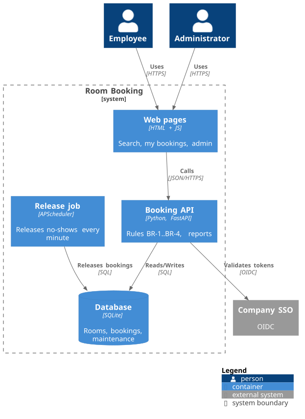
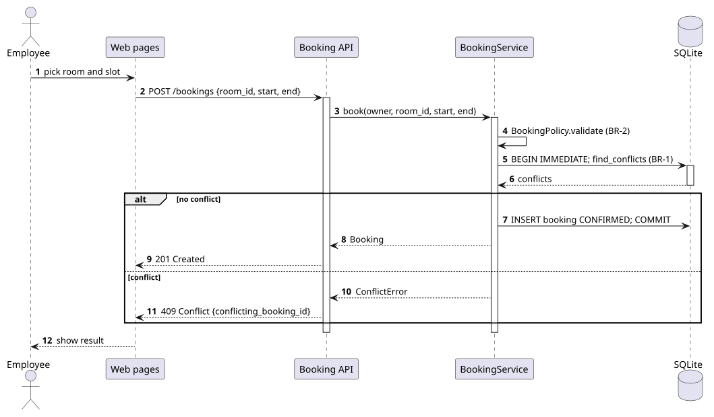
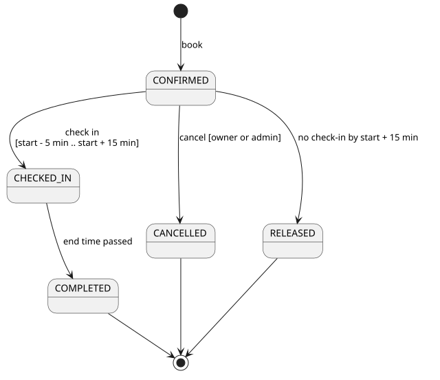
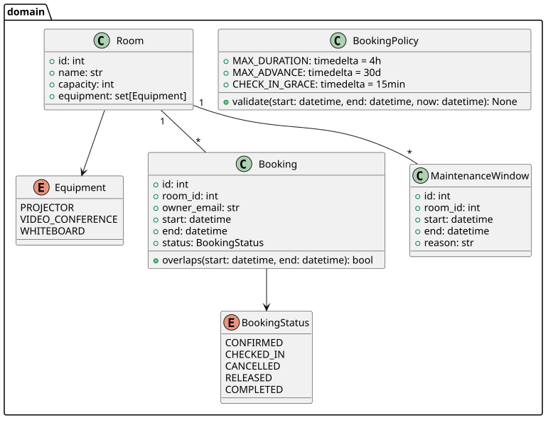
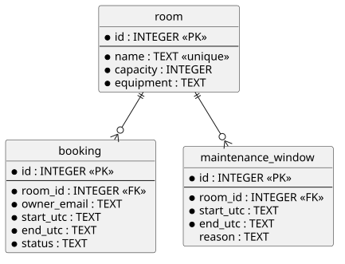
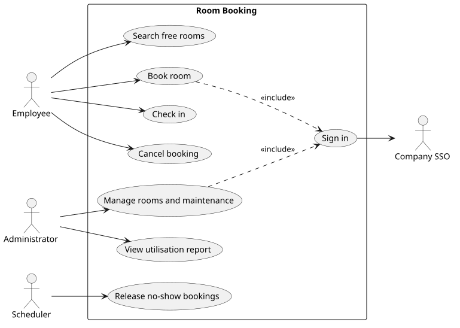

# NL2BP: Natural Language to UML Blueprint | 自然语言到 UML 蓝图

<div align="center">

[English](#english) | [中文](#中文)

[](https://opensource.org/licenses/MIT)
[](https://plantuml.com/)
[](skills/nl2bp/)
[](https://github.com/MarkfuGod/NL2BP-Natural-Language-to-UML-Blueprints/actions/workflows/ci.yml)

</div>

---

## English

NL2BP turns a natural-language requirement into **requirements → architecture (C4) → a UML
blueprint in PlantUML → code that implements it**. The model writes; deterministic checks verify:
every diagram must pass PlantUML, the class diagrams are a contract the code is measured against,
and generated tests run in a Docker sandbox.

### Three ways to use it

| | What | Best for |
|---|---|---|
| **[Agent Skill `nl2bp`](skills/nl2bp/)** | `SKILL.md` + references (diagram selection, output contract, PlantUML 1.2026 syntax) + `nl2bp_check.py` | Claude Code and other agents that support [Agent Skills](https://agentskills.io/) |
| **[CrewAI runner](workflow_multi_agent/crewai_code/)** | `nl2bp multi` (5 agents) and `nl2bp single` (one agent, 7 roles), headless, any model | Batch runs, evaluation, CI |
| **[Roo Code modes](workflow_single_agent/)** | `.roomodes` + 7 role rules | Working inside Roo Code |

All three share one source of truth: [`skills/nl2bp/references/`](skills/nl2bp/references/).

### Quick start

**Skill (Claude Code):**
```bash
cp -R skills/nl2bp ~/.claude/skills/        # or <project>/.claude/skills/
brew install plantuml                        # validation and rendering
# then ask: "design a meeting-room booking system and give me the UML blueprint"
```

**Headless runner:**
```bash
cd workflow_multi_agent/crewai_code
uv sync && cp .env.example .env              # MODEL=anthropic/claude-sonnet-5-5, deepseek/deepseek-flash, ...
uv run nl2bp multi  --name RoomBooking --description-file evals/requirements/room-booking.md --language English
uv run nl2bp single --name RoomBooking --description-file evals/requirements/room-booking.md --language English
```

### Example

[`examples/meeting-room-booking/`](examples/meeting-room-booking/) was produced by following the
skill: 13 diagrams, all validated by PlantUML 1.2026, sources (`.puml`) next to the rendered SVGs.

| C4 container | Booking sequence | Booking lifecycle |
|:---:|:---:|:---:|
|  |  |  |

| Domain contract | Database schema | Use cases |
|:---:|:---:|:---:|
|  |  |  |

More in [examples/](examples/).

### Measured

Live runs on DeepSeek-V4.1-Flash, scored by [`evals/score.py`](workflow_multi_agent/crewai_code/evals/score.py):
with the quality gates, blueprint conformance went from 0.656 to 1.0 and generated backend tests
from failing to passing. Details and caveats (one requirement per arm):
[`evals/RESULTS.md`](workflow_multi_agent/crewai_code/evals/RESULTS.md).

### Repository layout

```
skills/nl2bp/                 Agent Skill: SKILL.md, references/, scripts/nl2bp_check.py
examples/                     generated examples (.md + .puml + .svg), reproducible
workflow_multi_agent/
  crewai_code/                CrewAI runner (nl2bp CLI), tests, evals
workflow_single_agent/
  role_prompts/rules-*/       7 role specs (also loaded by `nl2bp single`)
  .roomodes                   Roo Code modes
```

---

## 中文

NL2BP 把一段自然语言需求变成 **需求 → 架构（C4）→ PlantUML UML 蓝图 → 按蓝图实现的代码**。
模型负责写，确定性检查负责验：每张图都必须通过 PlantUML 语法检查，类图是代码要对照的契约，
生成的测试在 Docker 沙箱里实际运行。

### 三种用法

| | 内容 | 适合 |
|---|---|---|
| **[Agent Skill `nl2bp`](skills/nl2bp/)** | `SKILL.md` + 参考资料（选图指南、输出契约、PlantUML 1.2026 语法）+ `nl2bp_check.py` | Claude Code 及其他支持 [Agent Skills](https://agentskills.io/) 的 Agent |
| **[CrewAI 运行器](workflow_multi_agent/crewai_code/)** | `nl2bp multi`（5 个 Agent）与 `nl2bp single`（单 Agent 7 个角色），无界面、任意模型 | 批量运行、评测、CI |
| **[Roo Code 模式](workflow_single_agent/)** | `.roomodes` + 7 个角色规则 | 在 Roo Code 中使用 |

三者共用同一份知识：[`skills/nl2bp/references/`](skills/nl2bp/references/)。

### 快速开始

**Skill（Claude Code）：**
```bash
cp -R skills/nl2bp ~/.claude/skills/        # 或 <项目>/.claude/skills/
brew install plantuml                        # 校验与渲染
# 然后直接说：“设计一个会议室预订系统，给我 UML 蓝图”
```

**命令行运行器：**
```bash
cd workflow_multi_agent/crewai_code
uv sync && cp .env.example .env              # MODEL=anthropic/claude-sonnet-5-5、deepseek/deepseek-flash 等
uv run nl2bp multi  --name 会议室预订 --description-file evals/requirements/room-booking.md
uv run nl2bp single --name 会议室预订 --description-file evals/requirements/room-booking.md
```

### 示例

[`examples/meeting-room-booking/`](examples/meeting-room-booking/) 按 skill 流程生成：13 张图全部通过
PlantUML 1.2026 校验，`.puml` 源文件与渲染后的 SVG 放在一起（图见上方英文部分）。更多见 [examples/](examples/)。

### 实测

DeepSeek-V4.1-Flash 实测、[`evals/score.py`](workflow_multi_agent/crewai_code/evals/score.py) 独立评分：
加入质量闸门后，蓝图契约符合度从 0.656 提升到 1.0，生成的后端测试从失败变为通过。
细节与局限（每组只有一个需求）：[`evals/RESULTS.md`](workflow_multi_agent/crewai_code/evals/RESULTS.md)。

### 目录

```
skills/nl2bp/                 Agent Skill：SKILL.md、references/、scripts/nl2bp_check.py
examples/                     生成的示例（.md + .puml + .svg），可复现
workflow_multi_agent/
  crewai_code/                CrewAI 运行器（nl2bp 命令）、测试、评测
workflow_single_agent/
  role_prompts/rules-*/       7 个角色规格（nl2bp single 也加载它们）
  .roomodes                   Roo Code 模式
```
