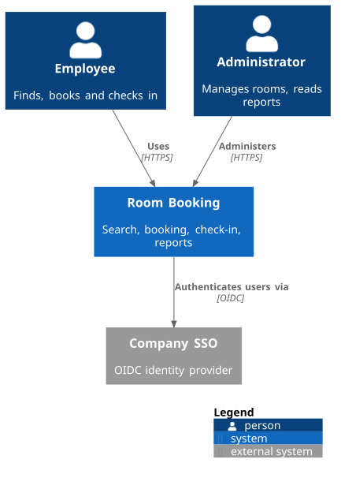
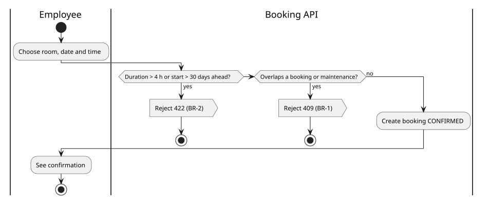
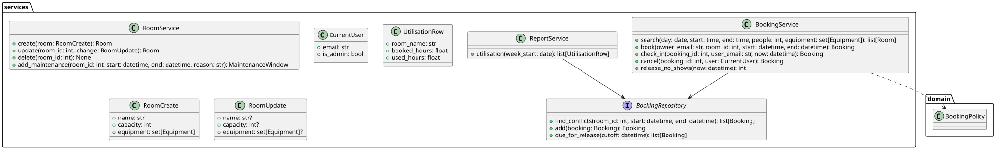
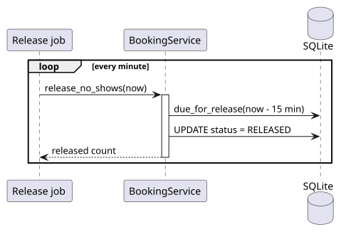
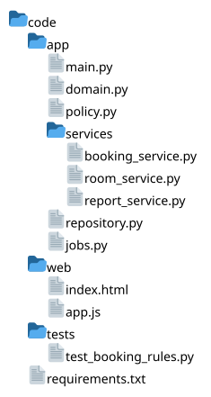
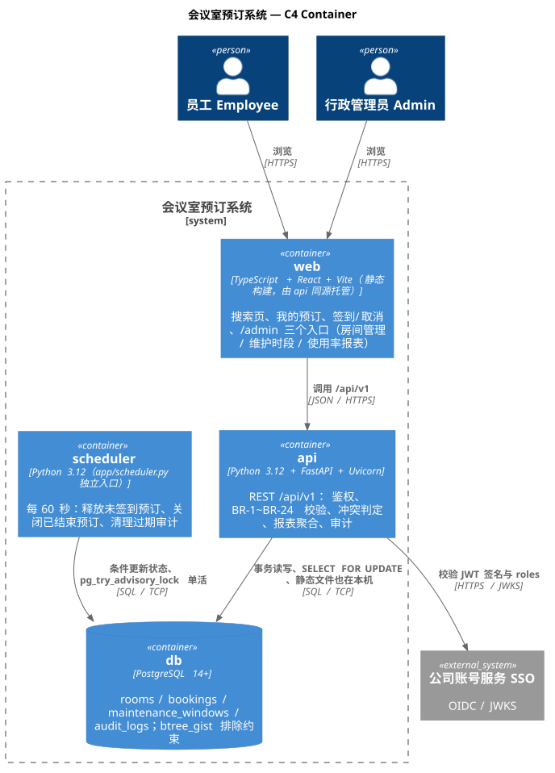
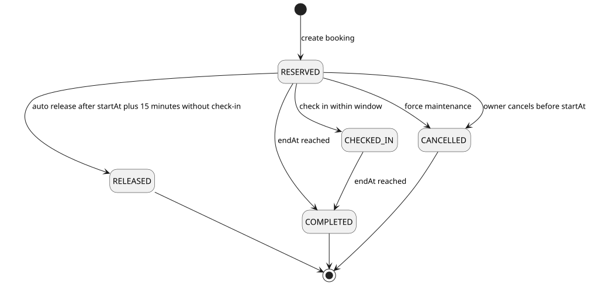
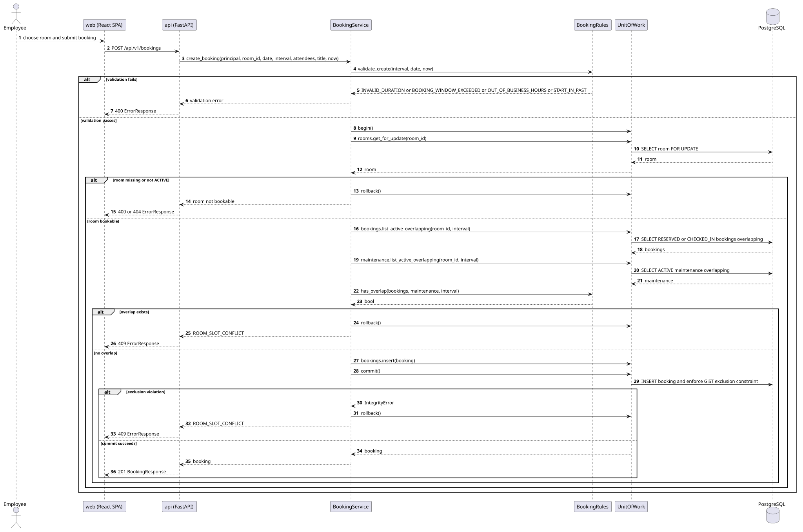
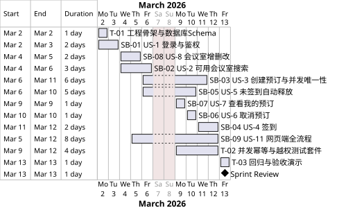

# Examples

Each example is the output of the [`nl2bp` skill](../skills/nl2bp/) workflow: the Markdown
documents are the source; `diagrams/` holds every diagram as `.puml` plus the rendered `.svg`.
Every diagram passes `plantuml -syntax` with PlantUML 1.2026 (checked in CI).

Regenerate all diagrams from the documents:

```bash
sh examples/regenerate.sh
```

| Example | How it was made | Diagrams |
|---|---|---|
| [meeting-room-booking](meeting-room-booking/) | Following the skill by hand (steps 1–4), English | use case, activity, C4 context/container, class (contract), sequence ×2, state, IE ER, JSON, files, Salt wireframe |
| [room-booking-crewai](room-booking-crewai/) | Unedited output of `nl2bp multi` on DeepSeek-V4.1-Flash (2026-11-26), Chinese | 28 diagrams: use case, activity ×3, C4 ×3, class ×4, sequence ×13, state ×2, IE ER, Gantt; code not included (backend tests: 145 passed) |

## meeting-room-booking

Requirement: [room-booking.md](../workflow_multi_agent/crewai_code/evals/requirements/room-booking.md).
Documents: [requirements](meeting-room-booking/requirements.md) ·
[architecture](meeting-room-booking/architecture.md) ·
[blueprint](meeting-room-booking/blueprint.md).

| | |
|:---:|:---:|
|  |  |
|  |  |
|  |  |

## room-booking-crewai

The same requirement run through the headless 5-agent workflow, copied without edits
(documents only; the generated code stayed in the run directory). Measured by
`evals/score.py`: 28/28 diagrams valid, blueprint conformance 1.0 (66 types), backend tests
145 passed in Docker. The model chose PostgreSQL + React (with a reason in the ADRs), although
the task prefers SQLite.

| | |
|:---:|:---:|
|  |  |
|  |  |
