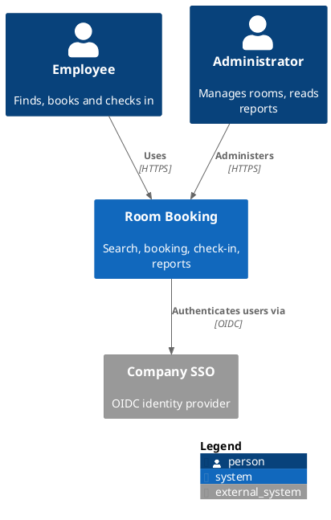
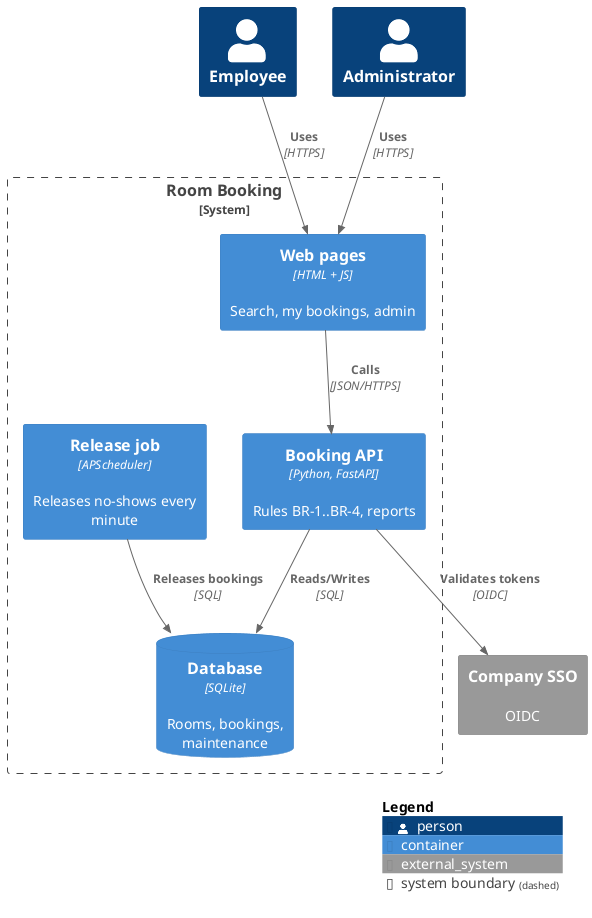

# Meeting room booking: architecture

> `skills/nl2bp` step 2.

## Stack

| Part | Choice | Reason |
|---|---|---|
| Backend | Python 3.12, FastAPI | Small JSON API, typed models, built-in OpenAPI |
| Storage | SQLite (WAL) | 300 users, 40 rooms; one writer is enough |
| Frontend | Static HTML + vanilla JS | Three pages; no build step needed |
| Jobs | APScheduler inside the API process | One periodic job (BR-3); no queue required |
| Auth | Company SSO via OIDC | NFR: no local passwords |
| Deploy | One Docker container on the internal VM | Single service |

## Decisions

- **ADR-1 Overlap check in the database.** Context: BR-1 must hold under concurrent requests.
  Decision: insert inside an `IMMEDIATE` transaction that re-checks overlap. Consequence:
  serialised writes, which SQLite handles easily at this scale.
- **ADR-2 Releases as a 1-minute job.** Context: BR-3. Decision: a scheduler job releases
  bookings whose start + 15 min has passed without check-in. Consequence: release happens
  within 1 minute of the deadline.

## C4 context

## C4 container

The release job runs inside the API process but is drawn separately because it acts without a
request.
