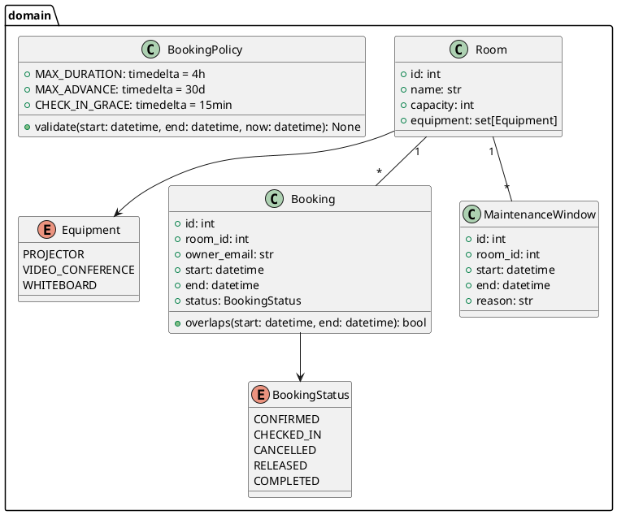
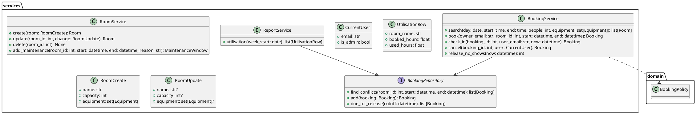
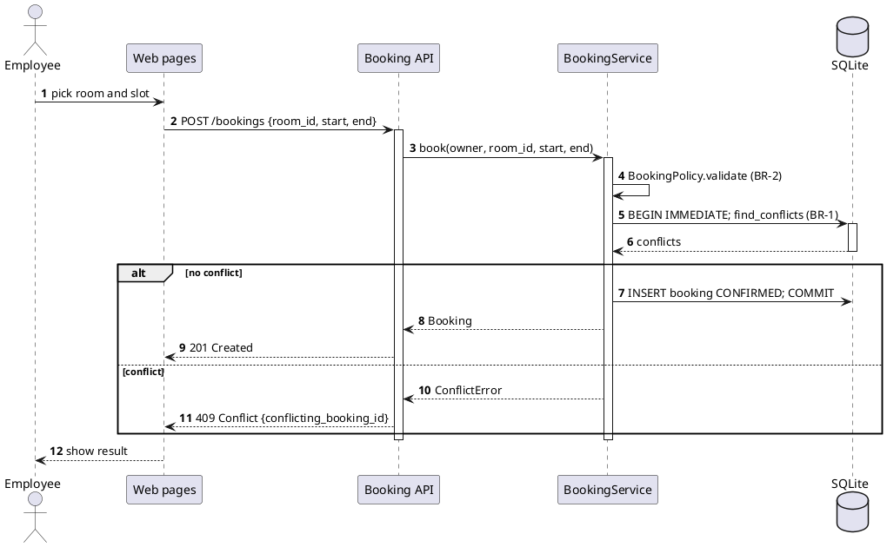
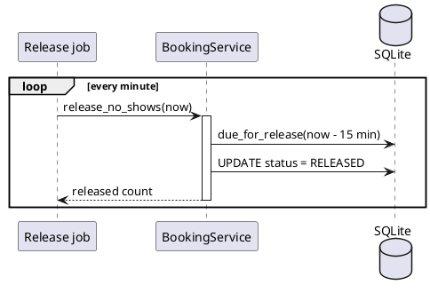
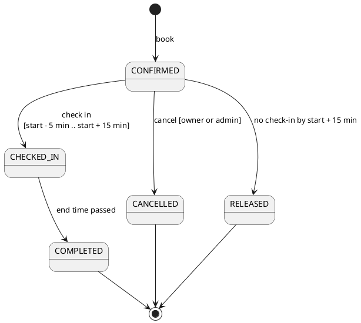
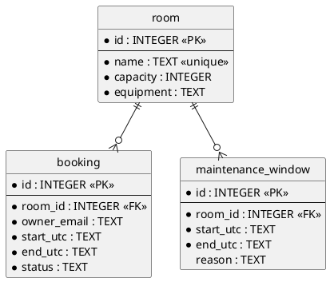
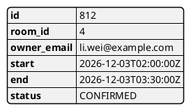
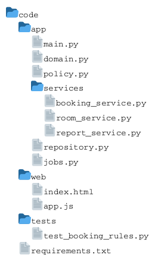
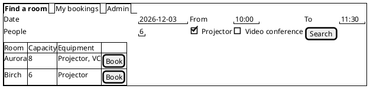

# Meeting room booking: blueprint

> `skills/nl2bp` step 3, following `references/output-contract.md`.

## Assumptions

- Times are stored as UTC ISO strings and shown in the office time zone.
- One booking covers exactly one room.

## Class diagram: domain (the implementation contract)

`BookingPolicy` holds the numbers from BR-2 and BR-3 so they live in one place. `overlaps` is the
predicate the repository uses for BR-1.

## Class diagram: services and API

The services are what the HTTP routes call; `BookingRepository` hides SQLite so the rules can
be tested with an in-memory fake.

## Sequence: book a room (US-2)

The conflict check and the insert share one `IMMEDIATE` transaction (ADR-1), so two concurrent
requests cannot both succeed.

## Sequence: release no-shows (BR-3)

## State diagram: booking lifecycle

Only `CONFIRMED` and `CHECKED_IN` count as active for the overlap rule.

## Entity-relationship: database schema

Index `booking(room_id, start_utc)` serves the overlap query.

## API payload: booking

## File structure

## Wireframe: search page

## Interfaces

| Endpoint | Request | Response | Errors |
|---|---|---|---|
| `GET /rooms/free` | `date, start, end, people, equipment[]` | `Room[]` | 422 |
| `POST /bookings` | `{room_id, start, end}` | `201 Booking` | 409 overlap, 422 BR-2 |
| `POST /bookings/{id}/check-in` | — | `Booking` | 403, 409 outside window |
| `DELETE /bookings/{id}` | — | `Booking (CANCELLED)` | 403 not owner/admin |
| `POST /rooms`, `PATCH /rooms/{id}`, `DELETE /rooms/{id}` | `RoomCreate` / `RoomUpdate` | `Room` | 403 not admin |
| `POST /rooms/{id}/maintenance` | `{start, end, reason}` | `MaintenanceWindow` | 409 overlaps a booking |
| `GET /reports/utilisation?week=` | — | `UtilisationRow[]` | 403 |

## Data flow

1. **Book:** validate BR-2 → in one transaction, check overlap with active bookings and
   maintenance (BR-1) → insert `CONFIRMED`.
2. **Check in:** owner only, inside [start − 5 min, start + 15 min] → `CHECKED_IN`.
3. **Release:** every minute, `CONFIRMED` bookings with start + 15 min < now → `RELEASED`.
4. **Report:** booked hours = sum of non-cancelled durations; used hours = checked-in durations.
