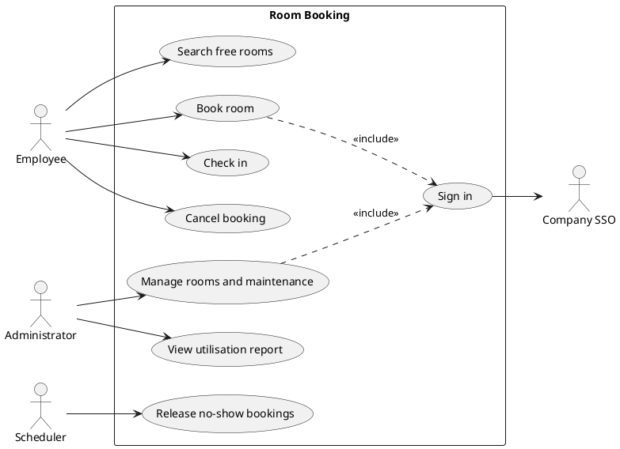
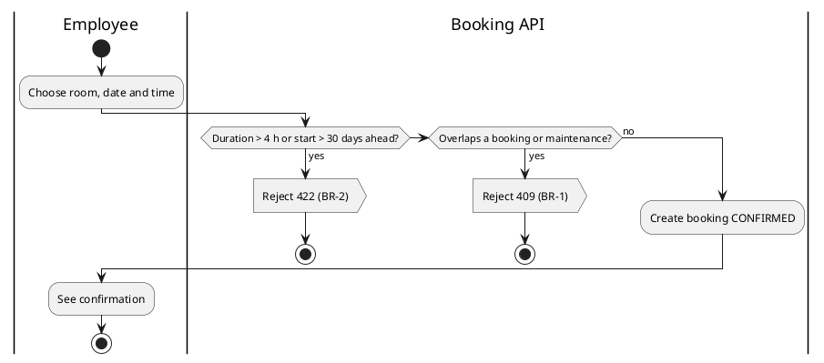

# Meeting room booking: requirements

> Generated by following `skills/nl2bp` step 1 on
> [`room-booking.md`](../../workflow_multi_agent/crewai_code/evals/requirements/room-booking.md).

## Goal and actors

Employees find and book free meeting rooms without double bookings; administrators manage
rooms and see how they are used.
Actors: **Employee**, **Administrator**, **Company SSO** (external), **Scheduler** (system clock).

## User stories

| ID | Story | Priority |
|---|---|---|
| US-1 | As an employee I want to search rooms by date, time, capacity and equipment so that I find a suitable free room | Must |
| US-2 | As an employee I want to book a free room so that the slot is mine | Must |
| US-3 | As an employee I want to check in when the meeting starts so that my booking is kept | Must |
| US-4 | As an employee I want to cancel my own booking so that others can use the room | Must |
| US-5 | As an administrator I want to add, edit and remove rooms and maintenance windows | Must |
| US-6 | As an administrator I want a utilisation report per room and week | Should |

Acceptance criteria (excerpt):

- **US-2** Given room R is free 10:00–11:00, when I book it, then the booking is `CONFIRMED`.
  Given an overlapping booking exists, when I book, then I get `409 Conflict`.
- **US-3** Given my booking starts at 10:00, when I check in between 09:55 and 10:15, then it is
  `CHECKED_IN`; when nobody checks in by 10:15, then it is `RELEASED` (BR-3).

## Business rules

| ID | Rule |
|---|---|
| BR-1 | No two active bookings of the same room may overlap; maintenance windows count as bookings |
| BR-2 | A booking lasts at most 4 hours and starts at most 30 days ahead |
| BR-3 | A booking not checked in within 15 minutes after its start is released automatically |
| BR-4 | Only the booking's owner or an administrator may cancel it |

## Non-functional requirements

- Sign-in through the company SSO (OIDC); no local passwords.
- About 300 employees and 40 rooms: a single service with SQLite is enough.

## Out of scope

Recurring meetings, calendar sync, catering.

## Assumptions

- Times are in the office's single time zone.
- Check-in opens 5 minutes before the start.

## Use case diagram

Employees search, book, check in and cancel; administrators manage rooms and read reports. The
scheduler is modelled as an actor because releasing no-shows (BR-3) happens without a user.

## Activity: booking a room

The two checks run in this order so that invalid requests never touch the overlap query.
