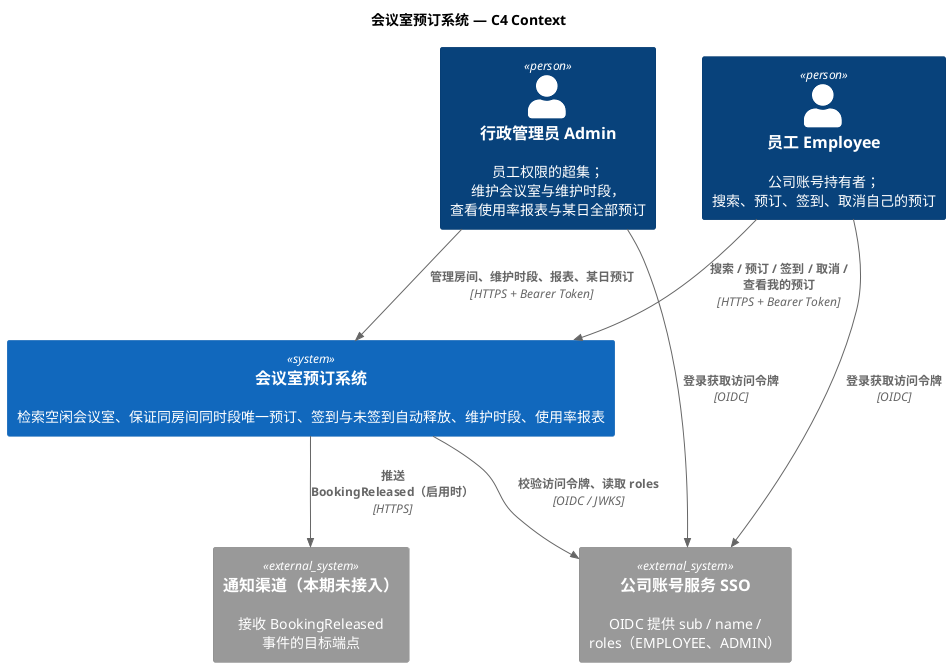
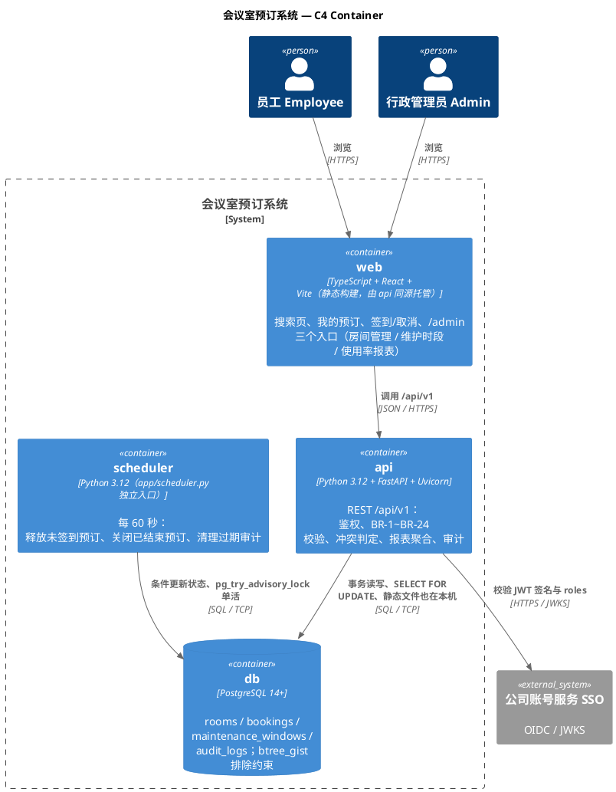

# 会议室预订系统 — 架构设计（architecture.md）

版本：v1.0　对应需求：requirements.md v1.0　时区基准：Asia/Shanghai（UTC+8）

---

## 0. 架构总览（一段话）

本系统由 **三个运行进程** 组成：无状态的 **api**（FastAPI，承载全部业务规则）、**scheduler**（独立常驻进程，每 60 秒推进预订状态）、以及 **db**（PostgreSQL 14+，同时承担唯一性约束、行级锁与审计留痕）。网页是 **api 同源托管的静态 SPA**，因此不构成独立容器，也天然满足 ASS-10 的同源要求。没有消息队列、没有缓存、没有搜索服务：需求的 10 万/年数据量（ASS-8）与 3 秒报表预算（NFR-3）都可以由单库 SQL 直接满足。

> 容器命名即代码命名：`api` = `app/main.py` 的 ASGI 应用，`scheduler` = `app/scheduler.py` 的常驻入口，`db` = `postgres` 容器。后续蓝图与部署脚本沿用这三个名字。

---

## 1. 技术栈（每项一行理由）

| 层 | 选型 | 理由（一行） |
|---|---|---|
| 语言 | Python 3.12 | 需求是“规则密集、计算轻”的形态（15 分钟粒度、半开区间、签到窗口、比率四舍五入），用 Python 表达与写测试成本最低，且团队偏好 Python。 |
| Web 框架 | FastAPI + Pydantic v2 + Uvicorn | Pydantic 校验器可把 BR-1～BR-5 一对一映射为 `INVALID_DURATION` 等错误码，OpenAPI 自动产出即为 API 文档。 |
| 数据访问 | SQLAlchemy 2.0（同步 Session）+ Alembic | 需要在事务内显式写 `SELECT … FOR UPDATE`（NFR-2），同步 Session 的边界最清楚；Alembic 让排除约束与索引变更可审计。 |
| 存储 | PostgreSQL 14+ | NFR-2 明确要求“事务 + 行级排他锁 + 数据库约束”，SQLite 无 `SELECT … FOR UPDATE` 与 GiST 排除约束，因此本条覆盖“优先 SQLite”的默认建议。 |
| 前端 | TypeScript + React + Vite，构建产物由 api 同源托管 | US-11-AC2 要求预订成功后“我的预订”立即更新，SPA 最直接；不引入 nginx 容器，因为同源托管同时满足 ASS-10 与 NFR-9。 |
| 鉴权 | PyJWT + JWKS 缓存，实现在 FastAPI 依赖（`Depends`） | NFR-1 要求“鉴权在中间件层统一实现、业务层只读 roles”，依赖注入正好是这一层的边界。 |
| 调度 | 同代码库独立进程（asyncio 循环）+ PostgreSQL advisory lock | NFR-4 要求“独立进程/定时器 + 多实例单活”，用数据库锁即可满足，不引入 Celery/Redis。 |
| 部署目标 | 单台内网 Linux 主机，Docker Compose（api / scheduler / db） | ASS-8 规模（≤200 房间、≤5000 员工）单机足够，避免 K8s 与多节点运维成本。 |
| 测试 | pytest + httpx + testcontainers(PostgreSQL) | BR-8 的“100 并发成功数恰为 1”必须对真实 PG 验证，SQLite 替身会掩盖锁行为。 |

---

## 2. 架构决策记录（ADR）

### ADR-001 存储选用 PostgreSQL 而非 SQLite

- **背景**：NFR-2 要求“支持事务与行级锁的关系型数据库”，并明确“会议室时段唯一性由数据库约束 + 事务内排他锁共同保证”；BR-8 要求 100 并发同房间同时段成功数恰为 1。
- **决策**：使用 PostgreSQL 14+，`bookings.start_at/end_at` 用 `timestamptz`，并启用 `btree_gist` 扩展。
- **后果**：获得 `SELECT … FOR UPDATE` 与 `EXCLUDE USING gist` 能力；代价是部署需多一个 db 容器与备份策略，本地开发必须用容器而非文件库。

### ADR-002 冲突判定采用“行级排他锁 + GiST 排除约束”双保险

- **背景**：NFR-2 禁止“先查后写”的无锁实现；BR-6 规定半开区间 [start, end) 且端点相接不算冲突；BR-7 规定只有 `RESERVED/CHECKED_IN` 与 `ACTIVE` 维护时段参与判定。
- **决策**：`POST /bookings` 在一个事务内先 `SELECT … FROM rooms WHERE id = :roomId FOR UPDATE`，再执行应用层的 `OverlapPolicy.overlaps()` 判定；同时在 `bookings` 上加 `EXCLUDE USING gist (room_id WITH =, tstzrange(start_at, end_at) WITH &&) WHERE (status IN ('RESERVED','CHECKED_IN'))` 作为最后防线。
- **后果**：应用层保证返回 409 + `ROOM_SLOT_CONFLICT` 的语义，数据库约束保证任何代码路径（含并发、含未来新增的写入口）都不会产生双重预订；`CANCELLED/RELEASED/COMPLETED` 因 `WHERE` 谓词自动退出约束，取消后可立即重订（US-6-AC1）。

### ADR-003 scheduler 是独立容器，用 advisory lock 实现单活

- **背景**：NFR-4 要求释放任务“以独立进程/定时器运行、周期 60 秒、多实例时用分布式锁或单活选举”，且“任务不可用不得阻塞新预订创建”。
- **决策**：`scheduler` 从同一代码库的 `app/scheduler.py` 启动独立进程；每轮先 `pg_try_advisory_lock(:key)`，取不到锁直接结束本轮；每轮批量处理候选预订，单轮超时 10 秒（BR-14），事务内“改状态 + 写审计”原子提交。
- **后果**：api 与 scheduler 完全解耦，调度停摆不影响创建预订（NFR-6）；因为已用数据库锁，无需部署 Redis/ZooKeeper 之类的协调组件。

### ADR-004 前端为静态 SPA，由 api 同源托管（不设 nginx 容器）

- **背景**：US-11 需要 `/` 与 `/admin` 两个页面与即时的列表更新；ASS-10 要求“网页与 API 同源，共用同一套鉴权机制”。
- **决策**：Vite 构建产物放在 `app/static/`，由 FastAPI 的 `StaticFiles` 提供，`/api/v1/**` 走 JSON 路由，其余路径回退 `index.html`。
- **后果**：容器数从 4 降到 3，Cookie/Token 天然同源，无 CORS 配置；代价是静态资源与 API 共享进程，大流量静态请求需靠内网带宽兜底（ASS-8 规模下可忽略）。

### ADR-005 时间统一存 UTC，业务判定一律走 Asia/Shanghai

- **背景**：NFR-5 要求“数据库存 UTC、接口出入参 ISO 8601 带偏移、自然日与 07:00–22:00 按 Asia/Shanghai 判定”；BR-2/BR-3/BR-4 全部依赖这一基准。
- **决策**：列类型 `timestamptz`；Python 侧用标准库 `zoneinfo.ZoneInfo("Asia/Shanghai")`，把“今天”“30 天窗口”“22:00 上限”全部折算到该时区后再转 UTC 比较，禁止使用 `datetime.now()` 裸取本地时间。
- **后果**：服务器时区改动不影响结果（NFR-5 的可测试点）；代价是所有涉及“日期”的查询都要显式做时区折算，测试需覆盖跨日边界（如 22:00 与次日 07:00）。

### ADR-006 不自建用户表，OIDC 身份即用户

- **背景**：ASS-2 明确“系统不自建用户表，仅缓存 userId 与 displayName”；US-1 只要求 `GET /me` 返回令牌中的 `sub/name/roles`。
- **决策**：`bookings.booked_by` 直接存 SSO 的 `sub`（字符串），不建 `users` 表、不做外键；`roles` 每次请求从令牌读取，不落库。
- **后果**：省掉用户同步与角色变更同步两套逻辑；代价是历史预订只能显示 `userId`，报表也据此避免个人明细（US-10-AC6 反而更容易满足）。

### ADR-007 报表实时 SQL 聚合，不做预聚合表与缓存

- **背景**：NFR-3 给出报表 P95 ≤ 3 s（366 天、50 个房间）；BR-21/BR-22 的 availableMinutes 需要扣除 ACTIVE 维护时段。
- **决策**：`GET /admin/reports/utilization` 用一条带 `generate_series` 的聚合 SQL 计算每日 07:00–22:00 分钟数、维护扣除、三种状态时长，`round(x::numeric, 4)` 出比率，`availableMinutes = 0` 时在 SQL 里 `COALESCE` 成 0。
- **后果**：数据永远与预订表一致，无缓存失效问题；代价是每次查询都做区间展开，年量 10 万条（ASS-8）下实测满足 3 秒，若未来超量再考虑物化视图。

### ADR-008 通知用进程内端口（Protocol），不引入消息队列

- **背景**：US-13 是 Could，AC2 允许“渠道未配置时只记一条 `NOTIFY_SKIPPED` 日志且不影响主流程”；范围外已明确“通知渠道的实际投递不在本期”。
- **决策**：定义 `BookingNotifier` 协议（`notify_released(booking)`），默认实现为 `LoggingNotifier`，由依赖注入装配；不做事件表、不做重试队列。
- **后果**：满足 US-13-AC1/AC2 的可测性，且不增加任何基础组件；代价是进程重启会丢事件，这在“本期不实际投递”的前提下可接受。

### ADR-009 审计写同库 `audit_logs` 表，清理用 scheduler 内的定期任务

- **背景**：BR-24 要求审计覆盖会议室增删改、维护时段创建、force 取消、自动释放，保留 365 天；NFR-10 要求日志不含完整令牌。
- **决策**：审计与业务变更在同一事务内插入 `audit_logs`；scheduler 每日一轮执行 `DELETE FROM audit_logs WHERE created_at < now() - interval '365 days'`。
- **后果**：审计与状态变更强一致（US-5-AC5 的幂等要求靠“状态条件更新 + 影响行数=0 则跳过”保证）；代价是写路径多一次 INSERT，量级可忽略。

### ADR-010 接受单机部署的可用性取舍

- **背景**：NFR-6 要求月度可用性 99.5%。
- **决策**：单主机 Docker Compose，`restart: unless-stopped` + `/healthz` 探活 + 每日 `pg_dump` 备份；api 保持无状态，为将来水平扩容留出路径，但本期不部署副本。
- **后果**：单机故障即整体不可用，理论上低于 99.5%；这是为“最小架构”显式承担的已知风险，若业务方要求更强保障，加第二台 api 副本 + 托管数据库即可，无需改动代码。

---

## 3. C4 图

### 3.1 C4 Context — 谁在用、系统依赖谁

图中四个外部角色与需求 §1.2 的参与者表一一对应：员工与管理员是唯一的人类参与者，SSO 是唯一的身份来源（ADR-006 决定了系统不自建用户表），通知渠道是 US-13 预留的端口目标，本期不实现投递。定时任务不在此图中出现——它是系统内部容器，而非外部系统，详见 3.2。

### 3.2 C4 Container — 哪些进程在跑、如何通信

三个容器即三个进程：`api` 承载全部业务规则且无状态（ADR-010 的扩容前提），`scheduler` 只写状态不做业务校验（ADR-003），`db` 同时充当唯一性约束执行者与并发仲裁者（ADR-001/002）。`scheduler` 与 `api` 之间 **没有** 调用关系，二者只通过 `db` 中的状态字段耦合，这正是 NFR-6“释放任务不可用不阻塞新预订”的架构表达。

---

## 4. 非功能需求如何被满足

| NFR | 满足方式 | 落在哪个容器/ADR |
|---|---|---|
| **NFR-1 认证与授权** | FastAPI 依赖统一解析 `Authorization: Bearer`，校验签名与过期（8 小时由 SSO 签发），把 `userId/roles` 放进请求上下文；业务函数只读 `roles`，不碰令牌。`/healthz` 与静态资源在鉴权依赖之外。 | api；ADR-006 |
| **NFR-2 数据一致性** | 所有写路径在单个事务内完成；创建预订先对 `rooms` 行加排他锁（ADR-002），再由 GiST 排除约束兜底；代码库禁止“先查后写”写法，由测试用例审查。 | db + api；ADR-001/002 |
| **NFR-3 性能** | 查询 `rooms/available` 走 `(status, capacity)` 与预订区间索引；报表用单条聚合 SQL（ADR-007）；10 万/年数据量下无全表扫描需求。 | db；ADR-007 |
| **NFR-4 调度可靠性** | `scheduler` 为独立进程，60 秒周期，`pg_try_advisory_lock` 保证多实例单活；每轮 ≤10 秒、失败下一轮重试，恢复时间由周期决定（≤5 分钟）。 | scheduler；ADR-003 |
| **NFR-5 时间处理** | 列 `timestamptz` 存 UTC；接口出入参 ISO 8601 带偏移；自然日与 07:00–22:00 用 `ZoneInfo("Asia/Shanghai")` 折算；单测覆盖跨日与 22:00 边界。 | api + db；ADR-005 |
| **NFR-6 可用性** | api 无状态可重启；`/healthz` + `restart: unless-stopped`；scheduler 与 api 无直接依赖，调度挂掉不影响创建预订。单机风险已记录在 ADR-010。 | 全部；ADR-010 |
| **NFR-7 安全** | 全站 HTTPS（反代/内网证书）；Pydantic 严格模型做输入白名单（枚举、长度、粒度）；越权由“`booked_by == sub` 或 `ADMIN`”单一判定函数覆盖（US-4-AC4 / US-6-AC2 / US-12-AC2）；日志脱敏不打印令牌。 | api |
| **NFR-8 可观测性** | `api` 暴露 `/healthz` 与 `/metrics`（Prometheus 文本格式），埋点 `booking_conflict_total`、`auto_release_total`；`scheduler_lag_seconds` 由 scheduler 在每轮结束时以 gauge 写入同一指标端点。 | api + scheduler |
| **NFR-9 网页端** | Vite 产物做代码分割与预压缩，首屏只加载搜索页 chunk；CSS 用 1280px 三列 / 768px 单列两档断点；目标浏览器为最近两版 Chrome/Edge/Safari（不引 polyfill 库）。 | web |
| **NFR-10 数据保留与隐私** | `audit_logs` 保留 365 天后由 scheduler 定期删除（ADR-009）；报表 SQL 只 `GROUP BY room_id` 不选 `booked_by`（US-10-AC6）；日志中间件过滤 `Authorization` 头。 | db + scheduler；ADR-009 |

---

## 5. 明确不引入的组件（及原因）

| 未引入 | 原因 |
|---|---|
| Redis / 缓存 | NFR-3 的 500 ms / 800 ms 预算在单库索引下可达；缓存可用性数据会引入“搜得到却订不上”的裂缝（与 5.2 活动图共享判定函数的要求冲突）。 |
| 消息队列 | US-13 仅为 Could 且范围外声明“实际投递不在本期”，进程内端口足够（ADR-008）。 |
| 独立前端服务器（nginx） | 同源托管同时满足 ASS-10 与 NFR-9，少一个容器（ADR-004）。 |
| 用户表 / 用户同步服务 | ASS-2 明确不自建用户表（ADR-006）。 |
| 预聚合报表表 / 定时算报表 | ASS-8 数据量下单条聚合 SQL 即满足 3 秒预算（ADR-007）。 |
| K8s / 多节点编排 | ASS-8 规模单机可承载，扩容路径已由 api 无状态设计保留（ADR-010）。 |
