# room-booking blueprint

## Assumptions

- 采用 requirements.md 的 ASS-1：签到窗口为 `[startAt - 15 分钟, startAt + 15 分钟]`，未签到释放发生在 `startAt + 15 分钟`。
- `ADMIN` 可代替预订人执行签到（US-4-AC4 的例外语义）；取消接口仅允许预订人本人调用，管理员取消他人预订单走维护时段 `force=true` 流程。
- SSO 的 `sub` 直接作为 `bookedBy` / `userId`，系统不建 `users` 表；`roles` 每次请求从令牌读取。
- 数据库存 UTC `timestamptz`，业务上的自然日、`07:00–22:00`、30 天窗口一律按 `Asia/Shanghai` 折算。
- `checkInDeadline` 由 `startAt + 15 分钟` 计算得出，不单独持久化；ER 图中不建列。
- API JSON 使用 camelCase（`userId`、`roomId`、`startAt`、`checkInDeadline`），Python DTO 字段使用 snake_case 并通过别名导出。
- `MaintenanceStatus` 只定义 `ACTIVE`，因为需求只使用 `status = ACTIVE` 的维护时段参与冲突判定；本期不提供维护时段取消接口。
- 通知渠道本期不实际投递，`BookingNotifier` 默认实现为 `LoggingNotifier`，未配置时记录 `NOTIFY_SKIPPED`。
- 冲突判定同时使用应用层 `OverlapPolicy` 与 PostgreSQL GiST 排除约束；应用层负责 409 语义，数据库约束负责并发最后防线。

## Class: 领域模型

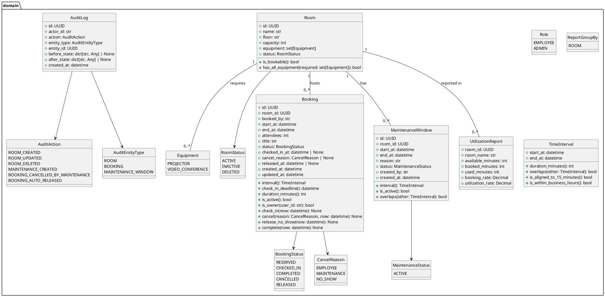

该图是领域层必须存在的类型清单：`Room`、`Booking`、`MaintenanceWindow`、`AuditLog`、`UtilizationReport` 与全部枚举。`TimeInterval` 统一承载半开区间重叠语义，避免搜索、创建预订、维护时段各自复制一套区间判定。

## Class: 服务与策略

```plantuml
@startuml room_booking_class_services
hide circle
package services {
  class AuthPrincipal {
    +user_id: str
    +display_name: str
    +roles: set[Role]
    +is_admin(): bool
    +has_role(role: Role): bool
  }

  interface TokenVerifier {
    +verify(token: str) -> AuthPrincipal
  }

  class OverlapPolicy {
    +overlaps(a: TimeInterval, b: TimeInterval): bool
  }

  class BookingRules {
    +MIN_DURATION_MINUTES: int = 15
    +MAX_DURATION_MINUTES: int = 240
    +BOOKING_WINDOW_DAYS: int = 30
    +validate_create(interval: TimeInterval, date: date, now: datetime): None
    +validate_search(date: date, interval: TimeInterval): None
    +validate_check_in(booking: Booking, principal: AuthPrincipal, now: datetime): None
    +validate_cancel(booking: Booking, principal: AuthPrincipal, now: datetime): None
    +validate_room(name: str, floor: str, capacity: int): None
    +validate_maintenance(interval: TimeInterval, now: datetime): None
    +validate_report_range(from_date: date, to_date: date): None
  }

  class BookingService {
    +search_available(date: date, interval: TimeInterval, attendees: int, equipment: set[Equipment], page: int, size: int) -> RoomPage
    +create_booking(principal: AuthPrincipal, room_id: UUID, date: date, interval: TimeInterval, attendees: int, title: str, now: datetime) -> Booking
    +check_in(principal: AuthPrincipal, booking_id: UUID, now: datetime) -> Booking
    +cancel(principal: AuthPrincipal, booking_id: UUID, now: datetime) -> Booking
    +list_mine(principal: AuthPrincipal, from_date: date, to_date: date, status: BookingStatus | None) -> list[Booking]
  }

  class RoomAdminService {
    +create_room(principal: AuthPrincipal, name: str, floor: str, capacity: int, equipment: set[Equipment]) -> Room
    +update_room(principal: AuthPrincipal, room_id: UUID, name: str | None, floor: str | None, capacity: int | None, equipment: set[Equipment] | None) -> Room
    +delete_room(principal: AuthPrincipal, room_id: UUID, now: datetime) -> None
  }

  class MaintenanceService {
    +create_window(principal: AuthPrincipal, room_id: UUID, interval: TimeInterval, reason: str, force: bool, now: datetime) -> MaintenanceWindow
  }

  class ReportService {
    +utilization(from_date: date, to_date: date, group_by: ReportGroupBy) -> list[UtilizationReport]
  }

  class AdminBookingService {
    +list_by_date(on_date: date) -> list[Booking]
  }

  class AuditService {
    +record(actor_id: str, action: AuditAction, entity_type: AuditEntityType, entity_id: UUID, before_state: dict[str, Any] | None, after_state: dict[str, Any] | None) -> None
  }

  interface BookingNotifier {
    +notify_released(booking_id: UUID, reason: CancelReason, released_at: datetime) -> None
  }

  class LoggingNotifier {
    +notify_released(booking_id: UUID, reason: CancelReason, released_at: datetime) -> None
  }

  class SchedulerResult {
    +released_count: int
    +completed_count: int
    +lag_seconds: float
  }

  class Scheduler {
    +run_once(now: datetime) -> SchedulerResult
    +run_forever() -> None
  }
}
AuthPrincipal --> Role
BookingService ..> BookingRules
BookingService ..> UnitOfWork
RoomAdminService ..> BookingRules
RoomAdminService ..> UnitOfWork
RoomAdminService ..> AuditService
MaintenanceService ..> BookingRules
MaintenanceService ..> UnitOfWork
MaintenanceService ..> AuditService
ReportService ..> BookingRules
ReportService ..> UnitOfWork
AdminBookingService ..> UnitOfWork
Scheduler ..> UnitOfWork
Scheduler ..> AuditService
Scheduler ..> BookingNotifier
LoggingNotifier ..|> BookingNotifier
BookingRules ..> OverlapPolicy
@enduml
```

该图声明业务服务、规则策略、鉴权端口和通知端口。`BookingService` 与 `MaintenanceService` 共享 `BookingRules` 与 `OverlapPolicy`，对应需求中“搜索可用”和“创建预订”不得各写一套冲突判定的约束。

## Class: 持久化端口

```plantuml
@startuml room_booking_class_persistence
hide circle
package persistence {
  interface UnitOfWork {
    +rooms: RoomRepository
    +bookings: BookingRepository
    +maintenance: MaintenanceRepository
    +audits: AuditRepository
    +commit(): None
    +rollback(): None
  }

  interface RoomRepository {
    +get(room_id: UUID) -> Room | None
    +get_for_update(room_id: UUID) -> Room | None
    +find_by_name(name: str) -> Room | None
    +list_available(date: date, interval: TimeInterval, attendees: int, equipment: set[Equipment], page: int, size: int) -> list[Room]
    +add(room: Room) -> None
    +save(room: Room) -> None
    +has_future_active_bookings(room_id: UUID, now: datetime) -> bool
    +list_future_active_bookings(room_id: UUID, now: datetime) -> list[Booking]
  }

  interface BookingRepository {
    +get(booking_id: UUID) -> Booking | None
    +get_for_update(booking_id: UUID) -> Booking | None
    +insert(booking: Booking) -> None
    +save(booking: Booking) -> None
    +list_active_overlapping(room_id: UUID, interval: TimeInterval) -> list[Booking]
    +list_mine(user_id: str, from_date: date, to_date: date, status: BookingStatus | None) -> list[Booking]
    +list_by_date(on_date: date) -> list[Booking]
    +list_reserved_candidates(now: datetime, limit: int) -> list[Booking]
    +list_completion_candidates(now: datetime, limit: int) -> list[Booking]
  }

  interface MaintenanceRepository {
    +list_active_overlapping(room_id: UUID, interval: TimeInterval) -> list[MaintenanceWindow]
    +add(window: MaintenanceWindow) -> None
    +list_active_in_range(room_id: UUID, from_at: datetime, to_at: datetime) -> list[MaintenanceWindow]
  }

  interface AuditRepository {
    +add(log: AuditLog) -> None
    +delete_older_than(cutoff: datetime) -> int
  }

  class SqlAlchemyUnitOfWork {
  }

  class SqlAlchemyRoomRepository {
  }

  class SqlAlchemyBookingRepository {
  }

  class SqlAlchemyMaintenanceRepository {
  }

  class SqlAlchemyAuditRepository {
  }
}
UnitOfWork <|.. SqlAlchemyUnitOfWork
RoomRepository <|.. SqlAlchemyRoomRepository
BookingRepository <|.. SqlAlchemyBookingRepository
MaintenanceRepository <|.. SqlAlchemyMaintenanceRepository
AuditRepository <|.. SqlAlchemyAuditRepository
@enduml
```

持久化端口把 `SELECT FOR UPDATE`、排除约束触发和审计写入封装在 `UnitOfWork` 边界内。服务层只依赖端口，不直接拼 SQL；创建预订必须先经过 `RoomRepository.get_for_update`。

## Class: API DTO 与错误码

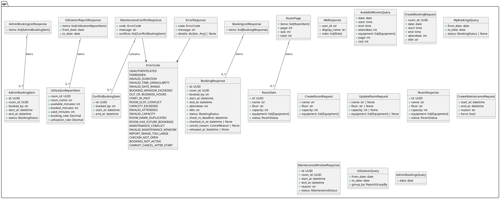

该图声明 REST 层所有请求、响应和错误码类型。错误码与需求中的 `INVALID_DURATION`、`ROOM_SLOT_CONFLICT`、`CHECKIN_NOT_OPEN` 等逐一对应，避免接口返回自由文本错误。

## Sequence: 登录与当前用户（US-1）

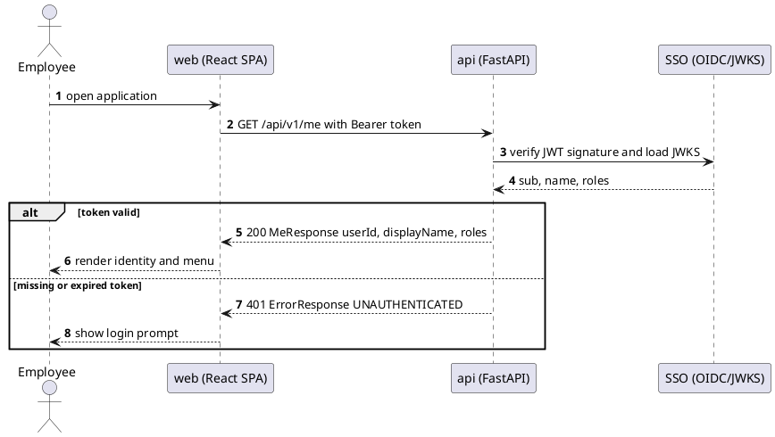

登录流程把身份来源完全交给 SSO，业务层只接收 `AuthPrincipal`。`/me` 返回的 `userId` 直接来自令牌 `sub`，因此后续预订归属判定不依赖请求体中的 `bookedBy`。

## Sequence: 搜索空闲会议室（US-2）

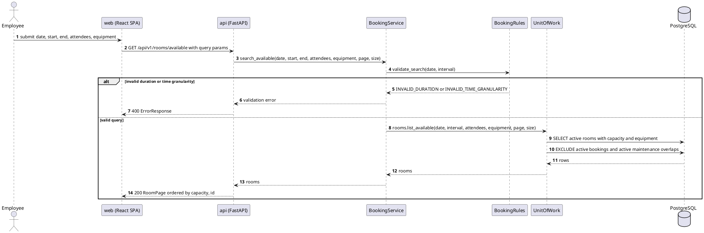

搜索在同一查询中应用容量、设备、房间状态和半开区间不重叠条件。端点相接不算冲突由 `TimeInterval.overlaps` 与 SQL 的 `tstzrange &&` 共同保证，不会把 `09:00–10:00` 与 `10:00–11:00` 判成冲突。

## Sequence: 创建预订（US-3）

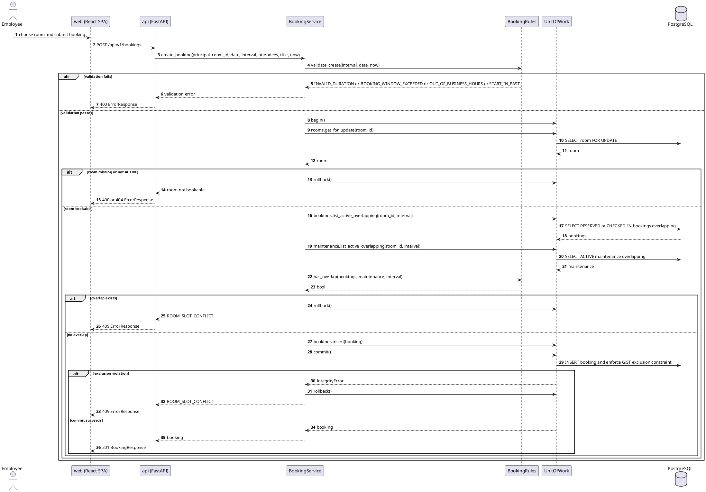

创建预订把规则校验与临界区分离：所有 400 前置校验完成后，才进入 `SELECT FOR UPDATE` 与区间重叠判定。即使应用层判断被并发穿透，GiST 排除约束仍会把第二个写入打断为 409，保证同房间同时段有效预订数不超过 1。

## Sequence: 签到（US-4）

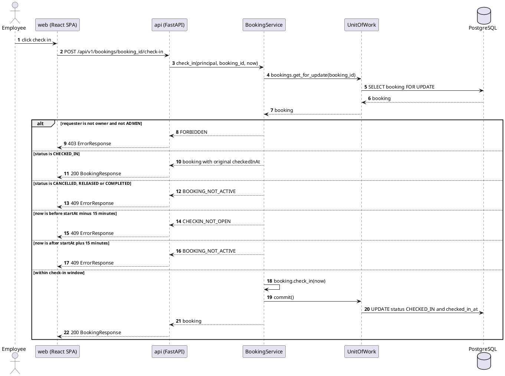

签到以行锁读取预订单，先判越权与状态，再判时间窗。已签到重复调用直接返回 200 且不覆盖 `checkedInAt`，满足幂等要求。

## Sequence: 未签到自动释放（US-5）

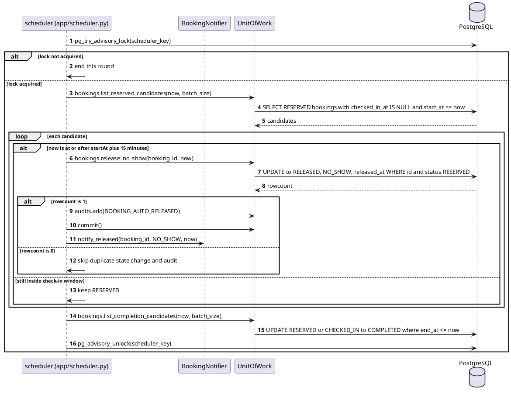

调度器先用 advisory lock 保证多实例单活，再用带 `status = RESERVED` 条件的更新实现幂等。释放、审计与通知在同轮内完成，通知失败不阻塞状态落库。

## Sequence: 取消自己的预订（US-6）

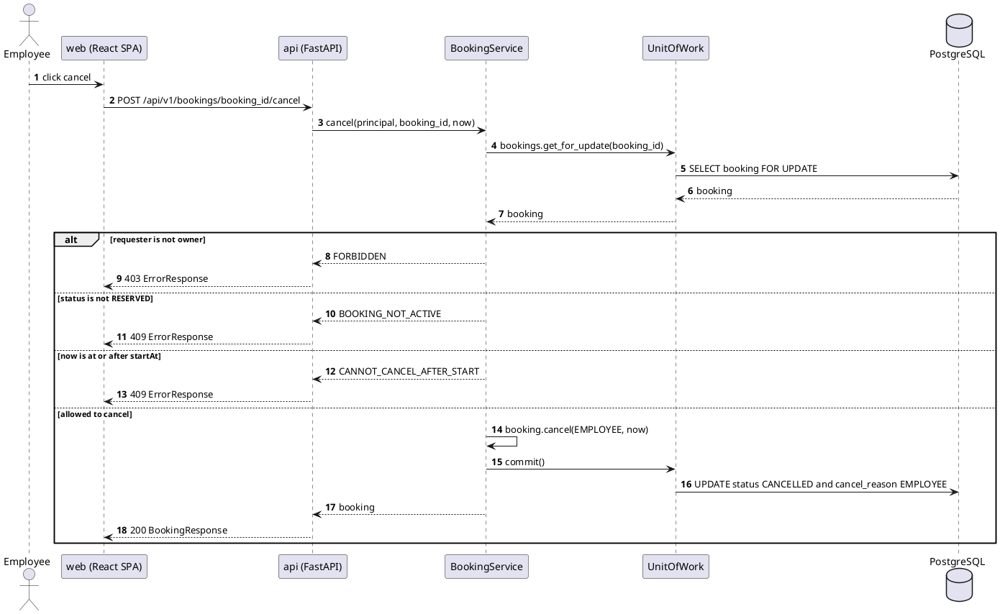

取消接口只允许预订人本人调用，并在行锁内检查状态与开始时间。状态变更提交后，该时段因 `CANCELLED` 退出 GiST 排除约束，立即可被他人重新预订。

## Sequence: 查看我的预订（US-7）

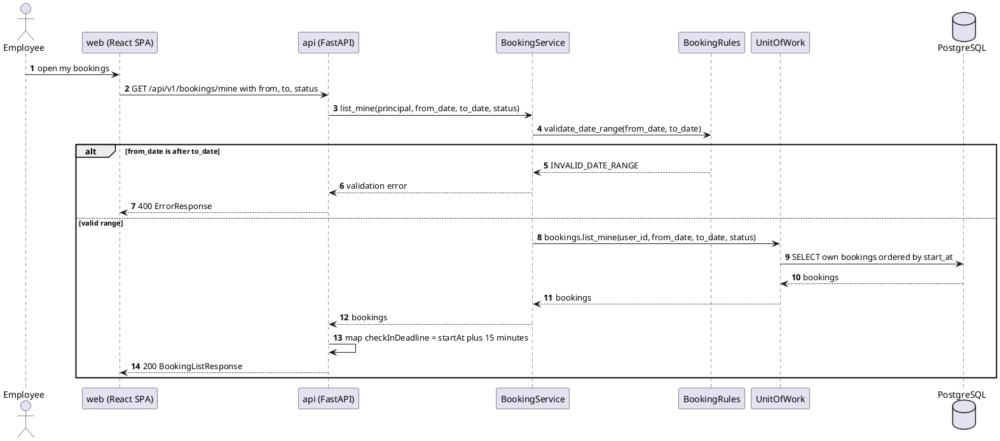

查询强制使用令牌 `sub` 作为过滤条件，跨用户不会返回数据。`checkInDeadline` 在响应映射阶段计算，保证每条 `RESERVED` 预订都带签到截止时间。

## Sequence: 管理员新增、修改、删除会议室（US-8）

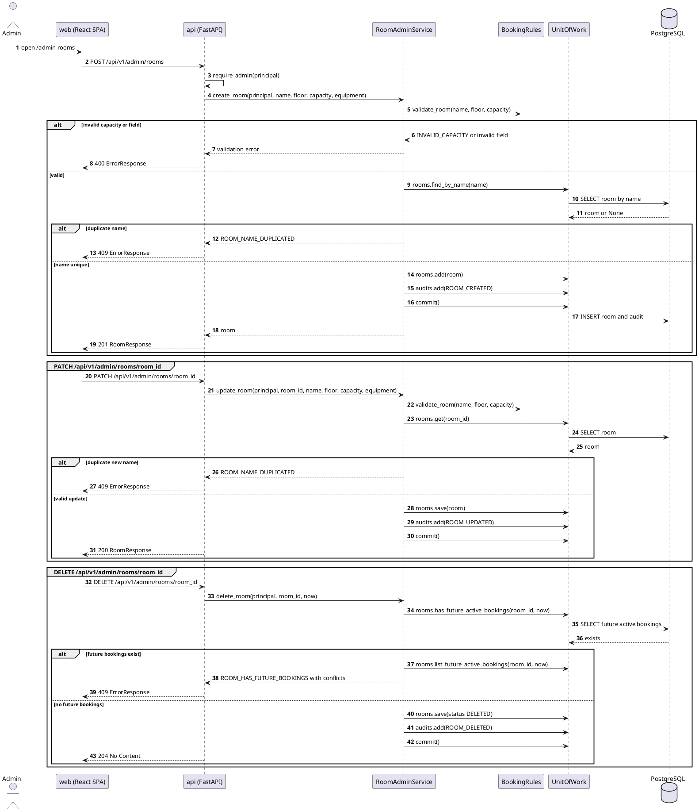

管理员会议室写操作统一先做角色检查与字段校验，再在事务内写业务数据与审计。删除采用软删除，存在未来有效预订时返回冲突清单而不是级联删除。

## Sequence: 设置维护时段（US-9）

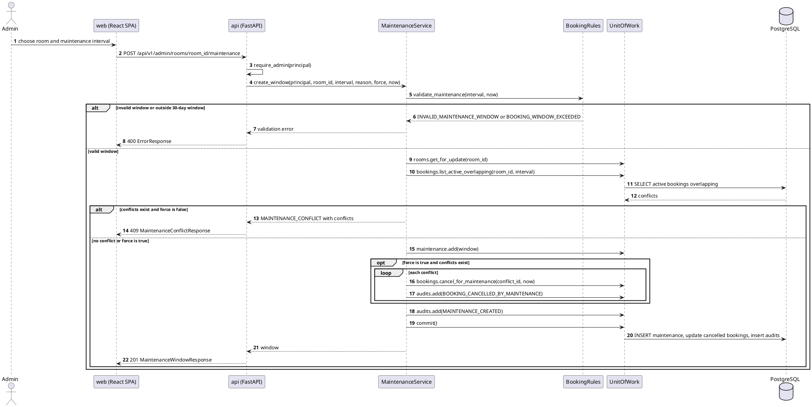

维护时段流程把“是否破坏既有预订”做成显式分支：`force=false` 返回 409 与冲突清单，`force=true` 才级联取消并逐条写审计。维护时段创建后立即参与可用搜索的排除条件。

## Sequence: 使用率报表（US-10）

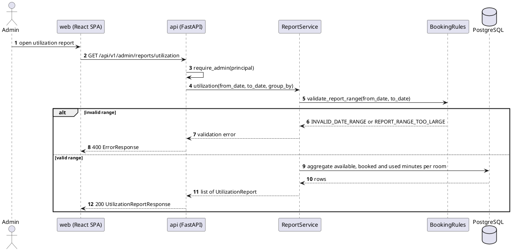

报表由一条实时聚合 SQL 生成，可用分钟数扣除 ACTIVE 维护时段，比率保留 4 位小数。SQL 只按房间聚合，不选择员工姓名或 `userId` 明细。

## Sequence: 管理员查看某日全部预订（US-12）

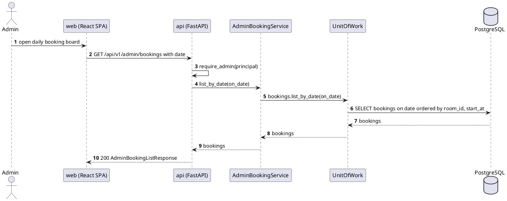

该接口只服务管理员，按 `roomId` 与 `startAt` 升序返回当天全部预订。响应包含 `bookedBy` 与 `status`，用于现场冲突排查。

## Sequence: 网页端预订全流程（US-11）

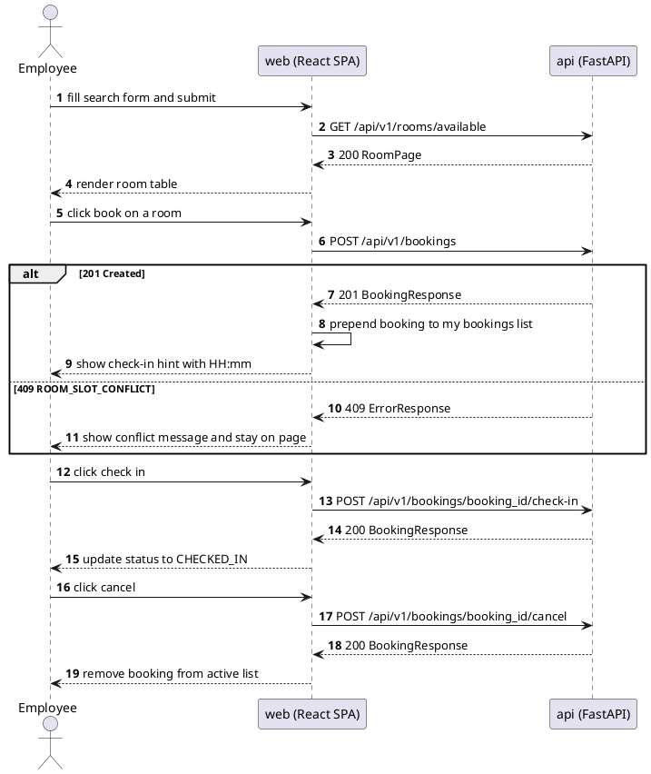

网页流程不等待手动刷新：创建成功后直接把返回的 `BookingResponse` 插入“我的预订”列表。409 冲突时只显示可读提示并保留当前搜索结果，符合 US-11-AC3。

## Sequence: 预订释放通知（US-13）

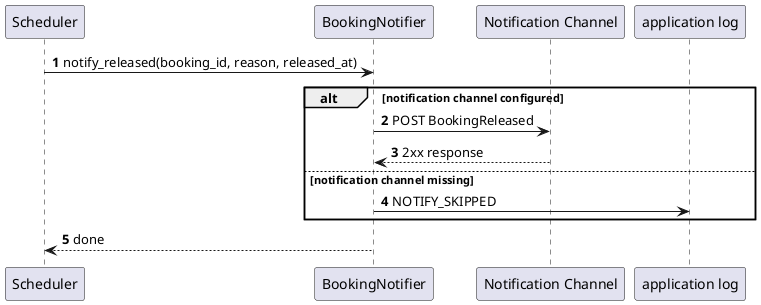

通知是进程内端口，不进入主事务；渠道未配置时只记录 `NOTIFY_SKIPPED`。这满足 US-13-AC2“通知失败不影响预订状态变更”。

## State: 预订生命周期

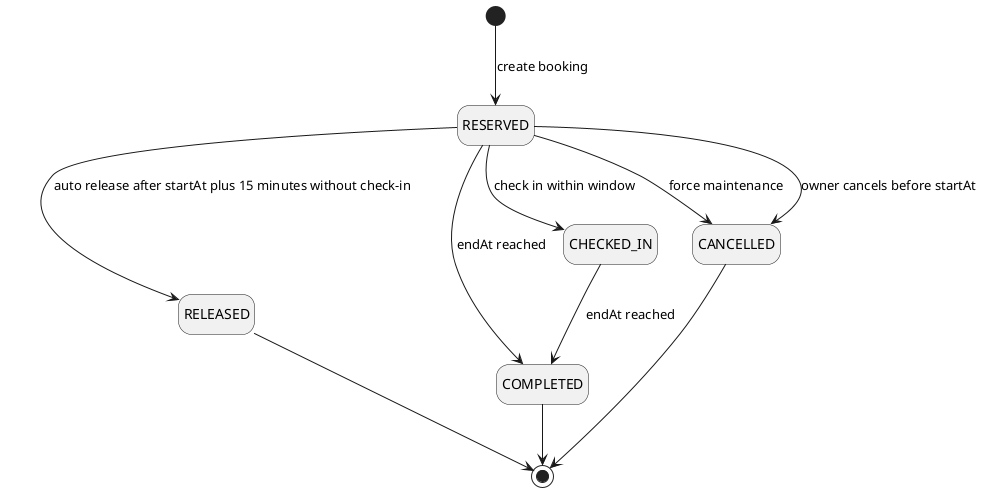

预订状态机把签到、自动释放、取消和完成四类迁移固定下来。`RELEASED` 与 `CANCELLED` 都是终态，不再参与冲突判定，也不能再次签到或取消。

## State: 会议室生命周期

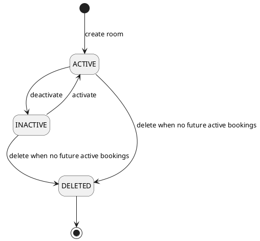

会议室只有 `ACTIVE` 可被搜索和预订；`DELETED` 为软删除终态，历史预订与报表数据仍保留。存在未来有效预订时，删除迁移被禁止并返回 `ROOM_HAS_FUTURE_BOOKINGS`。

## IE ER: 数据库 schema

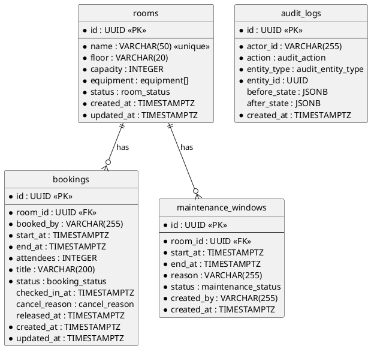

ER 图给出物理表与 PostgreSQL 类型：时间列统一 `TIMESTAMPTZ`，`bookings` 与 `maintenance_windows` 通过 `room_id` 关联 `rooms`。`audit_logs` 使用多态 `entity_id`，不建外键，以保留 365 天历史审计。

## Interfaces

| Endpoint / method | Request | Response | Errors |
|---|---|---|---|
| `GET /api/v1/me` | `Authorization: Bearer <token>` | `200 {userId, displayName, roles[]}` | `401 UNAUTHENTICATED` |
| `GET /api/v1/rooms/available` | Query: `date`, `start`, `end`, `attendees`, `equipment`, `page`, `size` | `200 {items[], page, size, total}`；无结果时 `items=[]` | `400 INVALID_DURATION`, `INVALID_TIME_GRANULARITY`, `OUT_OF_BUSINESS_HOURS`, `BOOKING_WINDOW_EXCEEDED`; `401 UNAUTHENTICATED` |
| `POST /api/v1/bookings` | Body: `{roomId, date, startTime, endTime, attendees, title}` | `201 BookingResponse`，含 `id`, `status`, `bookedBy`, `checkInDeadline` | `400 INVALID_DURATION`, `INVALID_TIME_GRANULARITY`, `BOOKING_WINDOW_EXCEEDED`, `OUT_OF_BUSINESS_HOURS`, `START_IN_PAST`, `CAPACITY_EXCEEDED`, `INVALID_ATTENDEES`; `401`; `403 FORBIDDEN`; `409 ROOM_SLOT_CONFLICT` |
| `POST /api/v1/bookings/{id}/check-in` | Path: `id` | `200 BookingResponse`，`status=CHECKED_IN`，`checkedInAt=now` | `401`; `403 FORBIDDEN`; `409 CHECKIN_NOT_OPEN`, `BOOKING_NOT_ACTIVE` |
| `POST /api/v1/bookings/{id}/cancel` | Path: `id` | `200 BookingResponse`，`status=CANCELLED`，`cancelReason=EMPLOYEE` | `401`; `403 FORBIDDEN`; `409 CANNOT_CANCEL_AFTER_START`, `BOOKING_NOT_ACTIVE` |
| `GET /api/v1/bookings/mine` | Query: `from`, `to`, `status` | `200 BookingListResponse`，按 `startAt` 升序，含 `checkInDeadline` | `400 INVALID_DATE_RANGE`; `401` |
| `POST /api/v1/admin/rooms` | Body: `{name, floor, capacity, equipment[]}` | `201 RoomResponse`，`status=ACTIVE` | `400 INVALID_CAPACITY`; `401`; `403 FORBIDDEN`; `409 ROOM_NAME_DUPLICATED` |
| `PATCH /api/v1/admin/rooms/{id}` | Path: `id`; Body: 可选 `{name, floor, capacity, equipment[]}` | `200 RoomResponse` | `400 INVALID_CAPACITY`; `401`; `403`; `409 ROOM_NAME_DUPLICATED` |
| `DELETE /api/v1/admin/rooms/{id}` | Path: `id` | `204 No Content`，`status=DELETED` | `401`; `403`; `409 ROOM_HAS_FUTURE_BOOKINGS`，响应含冲突预订 `id` 与 `startAt` |
| `POST /api/v1/admin/rooms/{roomId}/maintenance` | Path: `roomId`; Body: `{startAt, endAt, reason, force}` | `201 MaintenanceWindowResponse` | `400 INVALID_MAINTENANCE_WINDOW`, `BOOKING_WINDOW_EXCEEDED`, `OUT_OF_BUSINESS_HOURS`, `INVALID_TIME_GRANULARITY`; `401`; `403`; `409 MAINTENANCE_CONFLICT`，响应含 `conflicts[]` |
| `GET /api/v1/admin/reports/utilization` | Query: `from`, `to`, `groupBy=ROOM` | `200 {items[], from, to}`，含 `availableMinutes`, `bookedMinutes`, `usedMinutes`, `bookingRate`, `utilizationRate` | `400 INVALID_DATE_RANGE`, `REPORT_RANGE_TOO_LARGE`; `401`; `403` |
| `GET /api/v1/admin/bookings` | Query: `date` | `200 AdminBookingListResponse`，按 `roomId`, `startAt` 升序 | `401`; `403` |
| `GET /healthz` | 无 | `200` 健康状态 | 无 |
| `GET /metrics` | 无 | `200` Prometheus 文本 | 无 |

## Data flow

### 1. 登录与鉴权

1. 浏览器携带 `Authorization: Bearer <token>` 调用 `/api/v1/me`。
2. FastAPI 依赖调用 `TokenVerifier.verify`，从 JWKS 校验签名与过期时间。
3. 校验通过后构造 `AuthPrincipal(user_id=sub, display_name=name, roles=roles)`，写入请求上下文。
4. 业务层只读取 `AuthPrincipal.roles`，不接触原始令牌。
5. 缺失或过期令牌统一返回 `401 UNAUTHENTICATED`。

### 2. 搜索空闲会议室

1. 前端把日期、开始时间、结束时间、人数、设备提交到 `/api/v1/rooms/available`。
2. `BookingRules.validate_search` 校验时长 15–240 分钟、15 分钟粒度、业务时段与日期范围。
3. `RoomRepository.list_available` 查询 `status=ACTIVE`、容量足够、设备为所需集合超集的房间。
4. 同一 SQL 排除与 `RESERVED` / `CHECKED_IN` 预订及 `ACTIVE` 维护时段重叠的房间，按半开区间判定。
5. 结果按 `capacity` 升序、`id` 升序返回；无结果返回 `items=[]`。

### 3. 创建预订

1. 前端提交 `roomId`、日期、时段、人数、标题。
2. `BookingRules.validate_create` 执行 BR-1 至 BR-5 的全部前置校验，失败返回对应 400。
3. `UnitOfWork` 开启事务，`RoomRepository.get_for_update` 对会议室行加排他锁。
4. `BookingRepository.list_active_overlapping` 与 `MaintenanceRepository.list_active_overlapping` 读取冲突对象。
5. `OverlapPolicy.overlaps` 判定区间是否重叠；重叠则回滚并返回 `409 ROOM_SLOT_CONFLICT`。
6. 不重叠则插入 `Booking(status=RESERVED, booked_by=principal.user_id)`，提交事务。
7. 数据库 GiST 排除约束兜底并发；违反时同样返回 409。
8. 响应返回 `201`、`bookedBy` 与 `checkInDeadline=startAt+15min`。

### 4. 签到

1. 前端调用 `/api/v1/bookings/{id}/check-in`。
2. `BookingRepository.get_for_update` 锁定预订单。
3. 校验调用者为预订人或 `ADMIN`，否则 `403 FORBIDDEN`。
4. 若已是 `CHECKED_IN`，直接返回 200 且不覆盖 `checkedInAt`。
5. 若状态为 `CANCELLED` / `RELEASED` / `COMPLETED`，返回 `409 BOOKING_NOT_ACTIVE`。
6. 若 `now < startAt-15min` 返回 `409 CHECKIN_NOT_OPEN`；若 `now > startAt+15min` 返回 `409 BOOKING_NOT_ACTIVE`。
7. 窗口内更新 `status=CHECKED_IN`、`checked_in_at=now`，提交事务并返回 200。

### 5. 未签到自动释放

1. `Scheduler` 每 60 秒执行 `run_once`，先取 PostgreSQL advisory lock。
2. 查询 `status=RESERVED`、`checked_in_at IS NULL`、`start_at <= now` 的候选预订。
3. 对 `now >= start_at+15min` 的候选，条件更新为 `RELEASED`、`cancel_reason=NO_SHOW`、`released_at=now`。
4. 更新影响行数为 1 时写审计日志并调用 `BookingNotifier.notify_released`。
5. 更新影响行数为 0 时视为重复触发，跳过审计与通知。
6. 同轮把 `status IN (RESERVED, CHECKED_IN)` 且 `end_at <= now` 的预订置为 `COMPLETED`。
7. 释放 advisory lock，等待下一轮。

### 6. 取消自己的预订

1. 前端调用 `/api/v1/bookings/{id}/cancel`。
2. `BookingRepository.get_for_update` 锁定预订单。
3. 调用者不是 `booked_by` 时返回 `403 FORBIDDEN`。
4. 状态不是 `RESERVED` 时返回 `409 BOOKING_NOT_ACTIVE`。
5. `now >= start_at` 时返回 `409 CANNOT_CANCEL_AFTER_START`。
6. 否则更新 `status=CANCELLED`、`cancel_reason=EMPLOYEE`，提交事务，该时段立即退出冲突集合。

### 7. 查看我的预订

1. 前端带 `from`、`to`、可选 `status` 调用 `/api/v1/bookings/mine`。
2. `BookingRules.validate_date_range` 校验 `from <= to`，否则 `400 INVALID_DATE_RANGE`。
3. `BookingRepository.list_mine` 强制使用 `principal.user_id` 过滤，并按 `start_at` 升序。
4. 响应映射为 `BookingResponse`，对每条 `RESERVED` 计算 `checkInDeadline=startAt+15min`。

### 8. 管理员管理会议室

1. 管理员调用 `/api/v1/admin/rooms` 的 POST / PATCH / DELETE。
2. API 先执行 `require_admin`，非 ADMIN 返回 `403 FORBIDDEN`。
3. 创建与修改执行字段校验：名称 1–50、楼层 1–20、容量 1–100、设备枚举白名单。
4. 名称冲突返回 `409 ROOM_NAME_DUPLICATED`。
5. 删除前检查 `start_at > now` 且 `status IN (RESERVED, CHECKED_IN)` 的预订；存在则返回 `409 ROOM_HAS_FUTURE_BOOKINGS`。
6. 创建、修改、软删除均在事务内写 `audit_logs`。

### 9. 设置维护时段

1. 管理员提交 `{startAt, endAt, reason, force}`。
2. `BookingRules.validate_maintenance` 校验 `startAt < endAt`、15 分钟粒度、07:00–22:00、30 天提前期。
3. 锁定会议室行，查询与维护时段重叠的 `RESERVED` / `CHECKED_IN` 预订。
4. `force=false` 且存在冲突时返回 `409 MAINTENANCE_CONFLICT`，响应列出冲突预订。
5. `force=true` 时逐条把冲突预订置为 `CANCELLED`、`cancel_reason=MAINTENANCE`，并写审计。
6. 插入 `MaintenanceWindow(status=ACTIVE)` 并写审计，提交事务；该时段立即从可用搜索中剔除。

### 10. 使用率报表

1. 管理员调用 `/api/v1/admin/reports/utilization`。
2. `BookingRules.validate_report_range` 校验 `from <= to` 且跨度不超过 366 天。
3. `ReportService` 执行聚合 SQL：按每日 07:00–22:00 计算 `available_minutes`，扣除 ACTIVE 维护时段。
4. 同一 SQL 计算 `used_minutes`（CHECKED_IN + COMPLETED）与 `booked_minutes`（RESERVED + CHECKED_IN + COMPLETED）。
5. 比率用 `round(x, 4)` 输出；`available_minutes = 0` 时比率置 0.0。
6. 响应只含房间聚合值与房间信息，不含员工姓名或 `userId`。

### 11. 管理员查看某日全部预订

1. 管理员调用 `/api/v1/admin/bookings?date=YYYY-MM-DD`。
2. `require_admin` 通过后，`AdminBookingService.list_by_date` 查询当天全部预订。
3. 结果按 `room_id`、`start_at` 升序排列。
4. 响应包含 `bookedBy` 与 `status`，不返回其他员工敏感信息。

### 12. 网页端预订全流程

1. 搜索表单提交到可用会议室接口，表格渲染名称、楼层、容量、设备和预订按钮。
2. 点击预订后调用创建预订接口；201 时把返回记录插入“我的预订”列表并显示签到提示。
3. 409 `ROOM_SLOT_CONFLICT` 时显示“该时段已被预订，请重新搜索”，不跳转页面。
4. 点击签到调用签到接口，成功后更新该条状态为 `CHECKED_IN`。
5. 点击取消调用取消接口，成功后从有效列表移除该条。
6. `/admin` 入口根据 `roles` 控制显示；EMPLOYEE 访问时展示 403 页面。

### 13. 预订释放通知

1. 自动释放成功更新状态后，`Scheduler` 调用 `BookingNotifier.notify_released`。
2. 默认 `LoggingNotifier` 检查通知渠道是否配置。
3. 已配置时向通知渠道发送 `BookingReleased` 事件，事件含 `bookingId`、`reason`、`releasedAt`。
4. 未配置时记录 `NOTIFY_SKIPPED`，不影响主事务与预订状态。