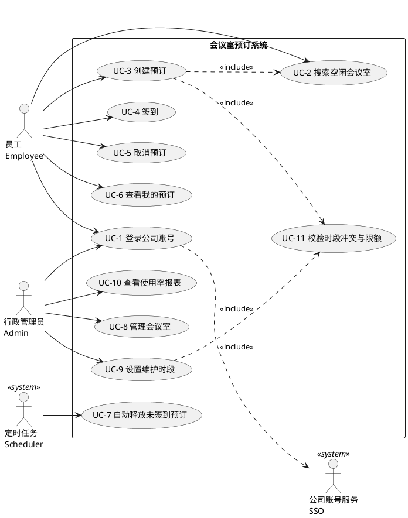
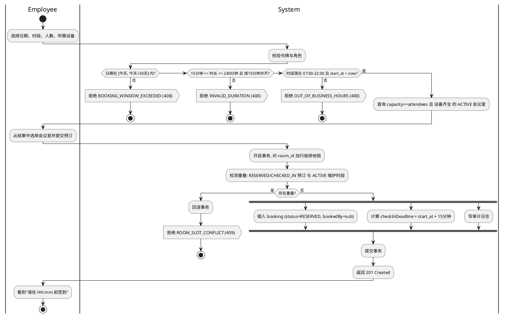
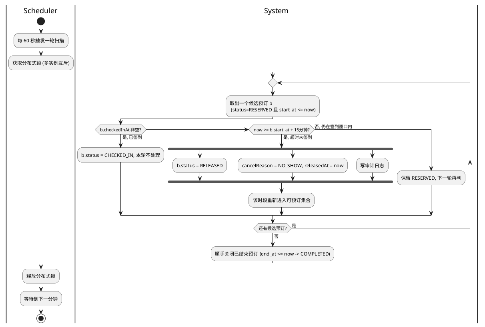
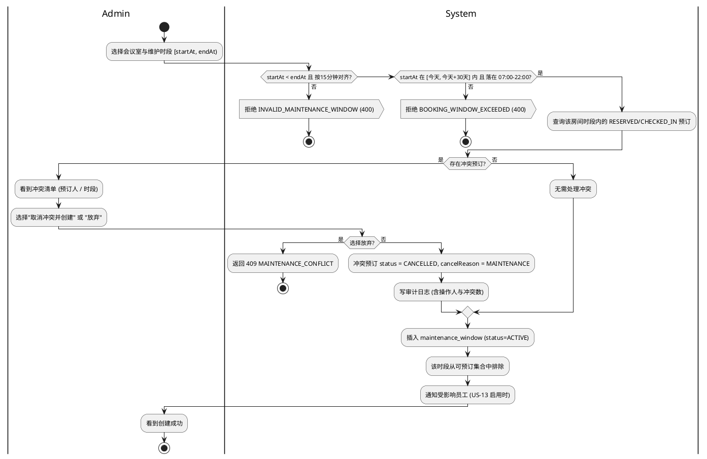

# 会议室预订系统 — 需求规格说明书（requirements.md）

版本：v1.0　编写阶段：需求分析　时区：Asia/Shanghai（UTC+8）

---

## 1. 目标（Goal）

为公司员工提供一个统一的会议室预订入口：登录公司账号后，按日期、时段、人数和设备检索空闲会议室并完成预订，系统严格保证同一会议室同一时段不被重复预订，并通过签到机制回收“订了不用”的时段。

行政管理员可维护会议室资源与维护时段，并以使用率报表衡量资源投入是否合理。

交付物为 REST API 与配套网页，二者共用同一套业务规则与数据模型。

### 1.2 参与者（Actors）

| 参与者 | 类型 | 说明 |
|---|---|---|
| 员工（Employee） | 人 | 公司账号持有者。可搜索、预订、签到、取消自己的预订、查看自己的预订。 |
| 行政管理员（Admin） | 人 | 员工权限的超集。额外可增删改会议室、设置维护时段、查看使用率报表、查看全部预订。 |
| 公司账号服务（SSO） | 外部系统 | 提供 OIDC 认证，返回 `sub`、`name`、`roles`（EMPLOYEE / ADMIN）。 |
| 定时任务（Scheduler） | 系统 | 每分钟扫描一次，自动释放未签到预订、关闭已结束预订。 |

> 说明：权限由 SSO 下发的 `roles` 决定，同一自然人可同时具备 EMPLOYEE 与 ADMIN 角色；具备 ADMIN 即可访问全部员工用例。

---

## 2. 用户故事（User Stories）

优先级采用 MoSCoW：Must / Should / Could / Won't（Won't 见 §4.2 范围外）。

### US-1 登录公司账号（Must）

**As a** 员工，**I want** 用公司账号登录系统，**so that** 我能以真实身份预订会议室，且系统能判定“我的预订”。

- **US-1-AC1** — **Given** 我持有有效的 SSO 令牌，**When** 我调用 `GET /api/v1/me` 并携带 `Authorization: Bearer <token>`，**Then** 返回 `200`，响应体含 `{userId, displayName, roles[]}`，且 `userId` 等于令牌的 `sub`。
- **US-1-AC2** — **Given** 我未携带令牌或令牌已过期，**When** 我调用任意 `/api/v1/**` 接口，**Then** 返回 `401`，错误码 `UNAUTHENTICATED`，响应体不含任何业务数据。
- **US-1-AC3** — **Given** 我的角色只有 `EMPLOYEE`，**When** 我调用 `POST /api/v1/admin/rooms`，**Then** 返回 `403`，错误码 `FORBIDDEN`。
- **US-1-AC4** — **Given** 我的角色含 `ADMIN`，**When** 我调用 `GET /api/v1/me`，**Then** `roles` 数组中包含 `ADMIN`。

### US-2 按条件搜索空闲会议室（Must）

**As a** 员工，**I want** 按日期、时段、人数和设备筛选出真正可用的会议室，**so that** 我不用逐个点开房间、也不会订到已被占用的房间。

接口：`GET /api/v1/rooms/available?date=2026-03-02&start=09:00&end=11:00&attendees=8&equipment=PROJECTOR,VIDEO_CONFERENCE&page=1&size=20`

- **US-2-AC1** — **Given** 参数为日期 `2026-03-02`、时段 `09:00–11:00`、人数 `8`、设备 `PROJECTOR,VIDEO_CONFERENCE`，**When** 调用该接口，**Then** 返回 `200`，`items` 中每个房间同时满足：`capacity >= 8`、`equipment` 集合包含全部所需设备、`status = ACTIVE`、且该时段与该房间所有 `RESERVED`/`CHECKED_IN` 预订及 ACTIVE 维护时段均**不重叠**；结果按 `capacity` 升序、`id` 升序排列。
- **US-2-AC2** — **Given** 不存在满足条件的会议室，**When** 调用该接口，**Then** 返回 `200` 且 `items = []`（不返回 `404`）。
- **US-2-AC3** — **Given** 时段为 `09:00–13:30`（时长 4.5 小时），**When** 调用该接口，**Then** 返回 `400`，错误码 `INVALID_DURATION`。
- **US-2-AC4** — **Given** 时段为 `08:50–09:50`（未按 15 分钟对齐），**When** 调用该接口，**Then** 返回 `400`，错误码 `INVALID_TIME_GRANULARITY`。
- **US-2-AC5** — **Given** 房间 A 在 `09:30–10:00` 已有 `RESERVED` 预订，**When** 我搜索 `09:00–10:00`，**Then** 房间 A 不在 `items` 中；**When** 我搜索 `10:00–11:00`，**Then** 房间 A 在 `items` 中（端点相接不算冲突）。

### US-3 创建预订（Must）

**As a** 员工，**I want** 一键预订选中的会议室时段，**so that** 我能锁定会议场地。

接口：`POST /api/v1/bookings`，请求体 `{roomId, date, startTime, endTime, attendees, title}`

- **US-3-AC1** — **Given** 房间可用、日期为今天 + 3 天、时段 `09:00–11:00`、人数 ≤ 房间容量，**When** 我提交预订，**Then** 返回 `201`，响应体含 `id`、`status = "RESERVED"`、`bookedBy = 我的 userId`、`checkInDeadline = start_at + 15 分钟`（ISO 8601 带时区偏移）。
- **US-3-AC2** — **Given** 该房间 `09:00–11:00` 已存在 `RESERVED` 预订，**When** 我提交同房间 `10:00–12:00` 的预订，**Then** 返回 `409`，错误码 `ROOM_SLOT_CONFLICT`，且数据库中不新增任何 booking 记录。
- **US-3-AC3** — **Given** 两个客户端并发提交同一房间 `09:00–11:00` 的预订，**When** 两个请求几乎同时到达，**Then** 恰好一个返回 `201`，另一个返回 `409`；且数据库中该房间该时段的有效预订（`RESERVED`/`CHECKED_IN`）条数恒为 `1`。
- **US-3-AC4** — **Given** 时段 `10:00–14:00`（4 小时，边界值），**When** 提交，**Then** 返回 `201`；**Given** 时段 `10:00–14:15`（4 小时 15 分），**When** 提交，**Then** 返回 `400`，错误码 `INVALID_DURATION`。
- **US-3-AC5** — **Given** 日期为今天 + 30 天，**When** 提交，**Then** 返回 `201`；**Given** 日期为今天 + 31 天，**When** 提交，**Then** 返回 `400`，错误码 `BOOKING_WINDOW_EXCEEDED`。
- **US-3-AC6** — **Given** 房间容量为 `8`，**When** 提交 `attendees = 9`，**Then** 返回 `400`，错误码 `CAPACITY_EXCEEDED`。
- **US-3-AC7** — **Given** 我的角色是 `EMPLOYEE`，**When** 我在请求体中伪造 `bookedBy = 他人 userId`，**Then** 返回 `201` 但 `bookedBy` 被强制写为令牌中的 `sub`（服务端忽略客户端传入的预订人）。

### US-4 预订签到（Must）

**As a** 员工，**I want** 在会议开始时签到，**so that** 我预订的时段不会被系统判定为“未到”而回收。

接口：`POST /api/v1/bookings/{id}/check-in`

- **US-4-AC1** — **Given** 我是该预订的预订人，当前时间 `now ∈ [start_at − 15min, start_at + 15min]`，`status = RESERVED`，**When** 我签到，**Then** 返回 `200`，`status = "CHECKED_IN"`，`checkedInAt = now`。
- **US-4-AC2** — **Given** `now < start_at − 15min`，**When** 我签到，**Then** 返回 `409`，错误码 `CHECKIN_NOT_OPEN`。
- **US-4-AC3** — **Given** 该预订已被自动释放（`status = RELEASED`），**When** 我签到，**Then** 返回 `409`，错误码 `BOOKING_NOT_ACTIVE`。
- **US-4-AC4** — **Given** 我不是该预订的预订人且我不是 ADMIN，**When** 我签到，**Then** 返回 `403`，错误码 `FORBIDDEN`。
- **US-4-AC5** — **Given** 我已签到，**When** 我再次签到，**Then** 返回 `200` 且 `checkedInAt` 保持不变（幂等）。

### US-5 未签到预订自动释放（Must）

**As a** 行政管理员 / 员工，**I want** 系统在会议开始 15 分钟后自动释放没签到的预订，**so that** 被浪费的会议室能重新被别人预订。

- **US-5-AC1** — **Given** 存在 `status = RESERVED`、`start_at + 15 分钟 <= now`、`checkedInAt` 为空的预订，**When** 定时任务运行，**Then** 该预订 `status` 变为 `RELEASED`、`cancelReason = "NO_SHOW"`、`releasedAt = now`，且写入一条审计日志。
- **US-5-AC2** — **Given** 一条预订在 `09:00` 开始且未签到，**When** 当前时间到达 `09:15:00`，**Then** 该预订在 `09:16:00` 之前（释放延迟 ≤ 60 秒）被置为 `RELEASED`。
- **US-5-AC3** — **Given** 某预订已被释放，**When** 另一个员工搜索该房间同一时段，**Then** 该房间出现在可用列表中，且可成功创建新预订（返回 `201`）。
- **US-5-AC4** — **Given** 一条已签到（`CHECKED_IN`）的预订结束时间已过，**When** 定时任务运行，**Then** 该预订 `status = "COMPLETED"`，且**不会**被置为 `RELEASED`。
- **US-5-AC5** — **Given** 定时任务对同一批数据连续执行两次（重复触发），**When** 第二次运行，**Then** 不产生重复的状态变更与重复审计日志（幂等）。

### US-6 取消自己的预订（Must）

**As a** 员工，**I want** 在会议开始前取消自己的预订，**so that** 我不占用不再需要的会议室，也方便同事预订。

接口：`POST /api/v1/bookings/{id}/cancel`

- **US-6-AC1** — **Given** 我是预订人、`status = RESERVED`、`now < start_at`，**When** 我取消，**Then** 返回 `200`，`status = "CANCELLED"`、`cancelReason = "EMPLOYEE"`，该时段立即出现在他人的可用搜索结果中。
- **US-6-AC2** — **Given** 该预订属于他人，**When** 我调用取消接口，**Then** 返回 `403`，错误码 `FORBIDDEN`，预订状态不变。
- **US-6-AC3** — **Given** `now >= start_at`，**When** 我取消，**Then** 返回 `409`，错误码 `CANNOT_CANCEL_AFTER_START`。
- **US-6-AC4** — **Given** 该预订已是 `CANCELLED` 或 `RELEASED`，**When** 我再次取消，**Then** 返回 `409`，错误码 `BOOKING_NOT_ACTIVE`。
- **US-6-AC5** — **Given** 我连续两次并发取消同一预订，**When** 两个请求同时到达，**Then** 恰好一个返回 `200`，另一个返回 `409`，`cancelReason` 不被覆盖。

### US-7 查看我的预订（Must）

**As a** 员工，**I want** 查看自己的预订列表与签到截止时间，**so that** 我不会漏掉签到。

接口：`GET /api/v1/bookings/mine?from=2026-03-01&to=2026-03-31&status=RESERVED`

- **US-7-AC1** — **Given** 我名下有 3 条预订、他人有 5 条，**When** 我调用该接口，**Then** 只返回我的 3 条，按 `start_at` 升序排列。
- **US-7-AC2** — **Given** 一条 `RESERVED` 预订，**When** 返回结果，**Then** 该条含 `checkInDeadline` 字段，值等于 `start_at + 15 分钟`。
- **US-7-AC3** — **Given** 我传入 `from > to`，**When** 调用该接口，**Then** 返回 `400`，错误码 `INVALID_DATE_RANGE`。

### US-8 管理员增删改会议室（Must）

**As a** 行政管理员，**I want** 新增、修改、删除会议室及其容量和设备，**so that** 系统中的可预订资源与现实中的房间保持一致。

接口：`POST /api/v1/admin/rooms`、`PATCH /api/v1/admin/rooms/{id}`、`DELETE /api/v1/admin/rooms/{id}`

- **US-8-AC1** — **Given** 我提交 `{name:"A301", floor:"3", capacity:12, equipment:["PROJECTOR","VIDEO_CONFERENCE"]}`，**When** 调用新增接口，**Then** 返回 `201`，`status = "ACTIVE"`，且该房间立即出现在可用搜索结果中。
- **US-8-AC2** — **Given** 提交 `capacity = 0`，**When** 调用新增接口，**Then** 返回 `400`，错误码 `INVALID_CAPACITY`（容量取值 1–100）。
- **US-8-AC3** — **Given** 已存在同名会议室 `A301`，**When** 我再次以 `A301` 新增，**Then** 返回 `409`，错误码 `ROOM_NAME_DUPLICATED`。
- **US-8-AC4** — **Given** 会议室无任何未来有效预订，**When** 我删除它，**Then** 返回 `204`，其 `status` 变为 `DELETED`（软删除），不再出现在搜索结果与预订接口中，历史预订数据保留。
- **US-8-AC5** — **Given** 会议室存在 `start_at > now` 的 `RESERVED` 预订，**When** 我删除它，**Then** 返回 `409`，错误码 `ROOM_HAS_FUTURE_BOOKINGS`，响应体列出冲突预订的 `id` 与 `start_at`。

### US-9 管理员设置维护时段（Should）

**As a** 行政管理员，**I want** 为会议室设定维护时段，**so that** 保洁、检修期间该房间不会被预订。

接口：`POST /api/v1/admin/rooms/{roomId}/maintenance`，请求体 `{startAt, endAt, reason, force?}`

- **US-9-AC1** — **Given** 时段 `2026-03-05 14:00–16:00` 内该房间无有效预订，**When** 我提交 `force=false`，**Then** 返回 `201`，该时段从可用搜索结果中剔除。
- **US-9-AC2** — **Given** 时段内存在 2 条 `RESERVED` 预订，**When** 我提交 `force=false`，**Then** 返回 `409`，错误码 `MAINTENANCE_CONFLICT`，响应体 `conflicts` 数组含这 2 条预订的 `id`、`bookedBy`、`startAt`、`endAt`。
- **US-9-AC3** — **Given** 同上冲突，**When** 我提交 `force=true`，**Then** 返回 `201`，维护时段创建成功，且这 2 条预订 `status = "CANCELLED"`、`cancelReason = "MAINTENANCE"`，并各写一条审计日志。
- **US-9-AC4** — **Given** `startAt >= endAt`，**When** 提交，**Then** 返回 `400`，错误码 `INVALID_MAINTENANCE_WINDOW`。
- **US-9-AC5** — **Given** `startAt` 为今天 + 31 天，**When** 提交，**Then** 返回 `400`，错误码 `BOOKING_WINDOW_EXCEEDED`（维护时段同样受 30 天提前期约束）。

### US-10 管理员查看使用率报表（Should）

**As a** 行政管理员，**I want** 按会议室和时间段查看使用率，**so that** 我能判断哪些房间供不应求、哪些长期空置。

接口：`GET /api/v1/admin/reports/utilization?from=2026-03-01&to=2026-03-07&groupBy=ROOM`

- **US-10-AC1** — **Given** 统计区间内房间 A 的可预订总时长为 `100` 小时，其中 `CHECKED_IN` + `COMPLETED` 的预订总时长为 `25` 小时，**When** 我查询报表，**Then** 房间 A 的 `utilizationRate = 0.2500`（保留 4 位小数）。
- **US-10-AC2** — **Given** 同一区间内房间 A 所有有效预订（`RESERVED` + `CHECKED_IN` + `COMPLETED`）总时长为 `30` 小时，**When** 查询报表，**Then** 房间 A 的 `bookingRate = 0.3000`。
- **US-10-AC3** — **Given** 某房间在该区间内全部处于维护状态，可预订时长为 `0`，**When** 查询报表，**Then** 该房间 `utilizationRate = 0.0`、`bookingRate = 0.0`，接口返回 `200`（不得出现除零错误或 `NaN`）。
- **US-10-AC4** — **Given** 我以 `EMPLOYEE` 角色调用该接口，**When** 请求到达，**Then** 返回 `403`，错误码 `FORBIDDEN`。
- **US-10-AC5** — **Given** `from = 2026-01-01`、`to = 2027-06-01`（跨度 > 366 天），**When** 查询，**Then** 返回 `400`，错误码 `REPORT_RANGE_TOO_LARGE`。
- **US-10-AC6** — **Given** 报表返回结果，**When** 检查响应体，**Then** 不含任何员工姓名或 `userId` 明细（仅聚合数值与房间信息）。

### US-11 网页端完成预订全流程（Must）

**As a** 员工，**I want** 在浏览器里完成搜索、预订、签到、取消，**so that** 我不需要写代码或调接口。

- **US-11-AC1** — **Given** 我打开 `/`，**When** 页面加载完成，**Then** 显示搜索表单（日期、开始时间、结束时间、人数、设备多选、搜索按钮）与结果表格（名称 / 楼层 / 容量 / 设备 / 预订按钮）。
- **US-11-AC2** — **Given** 我点击某房间的“预订”并成功，**When** 接口返回 `201`，**Then** 页面显示“已预订，请在 `HH:mm` 前签到”，并在“我的预订”列表中立即出现该条记录（无需手动刷新）。
- **US-11-AC3** — **Given** 接口返回 `409 ROOM_SLOT_CONFLICT`，**When** 页面收到响应，**Then** 显示可读错误提示“该时段已被预订，请重新搜索”，且不跳转页面。
- **US-11-AC4** — **Given** 我是 `ADMIN` 并登录，**When** 打开 `/admin`，**Then** 可见“会议室管理 / 维护时段 / 使用率报表”三个入口；`EMPLOYEE` 访问 `/admin` 时显示 `403` 页面。

### US-12 管理员查看某日全部预订（Should）

**As a** 行政管理员，**I want** 查看某一天所有会议室的预订情况，**so that** 现场出现冲突或临时需求时我能快速判断。

接口：`GET /api/v1/admin/bookings?date=2026-03-05`

- **US-12-AC1** — **Given** 当天共有 12 条预订，**When** 我按日期查询，**Then** 返回全部 12 条，按 `roomId`、`start_at` 升序排列，含 `bookedBy`、`status`。
- **US-12-AC2** — **Given** 我是 `EMPLOYEE`，**When** 调用该接口，**Then** 返回 `403`，错误码 `FORBIDDEN`。

### US-13 预订状态变更通知（Could）

**As a** 员工，**I want** 预订被释放或被管理员取消时收到通知，**so that** 我能及时改约。

- **US-13-AC1** — **Given** 我的预订因未签到被释放，**When** 状态变为 `RELEASED`，**Then** 系统在 `60` 秒内向通知端口推送一条 `BookingReleased` 事件，事件体含 `bookingId`、`reason`、`releasedAt`。
- **US-13-AC2** — **Given** 通知渠道未配置，**When** 事件产生，**Then** 预订状态变更照常完成，仅记录一条 `NOTIFY_SKIPPED` 日志（通知失败不影响主流程）。

---

## 3. 业务规则（Business Rules）

### 3.1 时间与时长

- **BR-1（时长上下限）** 单次预订时长 `duration = end_at − start_at` 必须满足 `15 分钟 <= duration <= 240 分钟`（4 小时）。超出返回 `INVALID_DURATION`。
- **BR-2（提前期）** 允许预订的起始日期范围是 `[today, today + 30 天]`（按 Asia/Shanghai 自然日计算），且 `end_at <= today + 30 天 22:00`。超出返回 `BOOKING_WINDOW_EXCEEDED`。
- **BR-3（可预订时段）** 每日可预订区间为 `07:00–22:00`；区间外返回 `OUT_OF_BUSINESS_HOURS`。
- **BR-4（时间粒度）** `start_at` 与 `end_at` 的分值必须属于 `{00, 15, 30, 45}`，秒与毫秒必须为 `0`。违反返回 `INVALID_TIME_GRANULARITY`。
- **BR-5（过去时间）** `start_at` 必须晚于 `now`，否则返回 `START_IN_PAST`。

### 3.2 冲突与容量

- **BR-6（区间语义）** 所有时段按半开区间 `[start, end)` 处理。两个区间重叠当且仅当 `a.start < b.end AND b.start < a.end`；仅端点相接（如 `09:00–10:00` 与 `10:00–11:00`）不视为冲突。
- **BR-7（冲突对象）** 判定占用时，冲突对象包括：`status ∈ {RESERVED, CHECKED_IN}` 的预订，以及 `status = ACTIVE` 的维护时段。`CANCELLED` / `RELEASED` / `COMPLETED` 不参与冲突判定。冲突返回 `ROOM_SLOT_CONFLICT`（HTTP `409`）。
- **BR-8（并发唯一性）** 同一 `(room_id, 时间区间)` 的有效预订数量在任何时刻必须 `<= 1`。实现须在数据库事务内对 `room_id` 加行级排他锁（或使用等价的可串行化机制），`100` 并发同房间同时段请求下成功数必须恰为 `1`。
- **BR-9（容量）** `1 <= attendees <= room.capacity`，且 `room.capacity` 取值区间为 `1–100`。违反分别返回 `INVALID_ATTENDEES` / `CAPACITY_EXCEEDED` / `INVALID_CAPACITY`。
- **BR-10（设备）** 请求所需设备集合必须是 `room.equipment` 的子集；设备枚举仅 `PROJECTOR`、`VIDEO_CONFERENCE` 两种。
- **BR-11（会议室可用性）** 仅 `status = ACTIVE` 的会议室可被搜索与预订；`INACTIVE`、`DELETED` 一律不可预订。

### 3.3 签到与自动释放

- **BR-12（签到窗口）** 可签到时间窗为 `[start_at − 15 分钟, start_at + 15 分钟]`。早于窗口返回 `CHECKIN_NOT_OPEN`；晚于窗口（预订已被释放）返回 `BOOKING_NOT_ACTIVE`。
- **BR-13（自动释放条件）** 同时满足 `status = RESERVED`、`checkedInAt IS NULL`、`now >= start_at + 15 分钟` 的预订，必须被置为 `RELEASED`，`cancelReason = NO_SHOW`。
- **BR-14（释放时效）** 调度周期为 `60 秒`；从 `start_at + 15 分钟` 到状态落库的时间差必须 `<= 60 秒`。任务单次执行时长须 `<= 10 秒`，且必须幂等（重复执行不产生重复变更）。
- **BR-15（完成态）** 满足 `status ∈ {RESERVED, CHECKED_IN}` 且 `now >= end_at` 的预订，置为 `COMPLETED`。`COMPLETED` 不释放为 `RELEASED`。

### 3.4 取消

- **BR-16（取消主体与时机）** 仅预订人本人（或 ADMIN 通过维护时段流程）可取消；仅 `status = RESERVED` 且 `now < start_at` 时允许取消。取消后该时段立即可被他人预订。

### 3.5 权限

- **BR-17（权限矩阵）**
  - `EMPLOYEE`：可读 `GET /rooms/**`、可读写自己的 `bookings`（创建 / 签到 / 取消 / 查询自己）。
  - `ADMIN`：拥有 `EMPLOYEE` 全部权限，外加 `POST|PATCH|DELETE /admin/rooms/**`、`POST /admin/rooms/{id}/maintenance`、`GET /admin/reports/**`、`GET /admin/bookings`。
  - 任何跨用户写操作返回 `403 FORBIDDEN`；服务端一律忽略客户端传入的 `bookedBy`。

### 3.6 资源管理

- **BR-18（会议室字段约束）** `name` 长度 `1–50` 字符且全局唯一；`floor` 长度 `1–20`；`capacity` 整数 `1–100`；`equipment` 为枚举集合（可为空集）。
- **BR-19（软删除）** 删除会议室仅置 `status = DELETED`；历史预订与报表数据保留。存在 `start_at > now` 且 `status ∈ {RESERVED, CHECKED_IN}` 的预订时禁止删除，返回 `ROOM_HAS_FUTURE_BOOKINGS`。
- **BR-20（维护时段）** 维护时段同样受 `BR-2`（30 天）、`BR-3`（07:00–22:00）、`BR-4`（15 分钟粒度）、`BR-6`（区间语义）约束；冲突且 `force = false` 时返回 `MAINTENANCE_CONFLICT`，`force = true` 时冲突预订置为 `CANCELLED`（`cancelReason = MAINTENANCE`）。

### 3.7 报表

- **BR-21（可预订时长）** 对房间 `r` 与区间 `[from, to]`：`availableMinutes = Σ每日 07:00–22:00 的分钟数 − ACTIVE 维护时段落在区间内的分钟数`。
- **BR-22（使用率定义）**
  - `usedMinutes = Σ(status ∈ {CHECKED_IN, COMPLETED} 的预订时长)`
  - `bookedMinutes = Σ(status ∈ {RESERVED, CHECKED_IN, COMPLETED} 的预订时长)`
  - `utilizationRate = round(usedMinutes / availableMinutes, 4)`，`bookingRate = round(bookedMinutes / availableMinutes, 4)`
  - `availableMinutes = 0` 时两比率均返回 `0.0`，HTTP 仍为 `200`。
- **BR-23（报表范围）** 单次查询区间 `to − from <= 366 天`，且 `from <= to`；违反返回 `REPORT_RANGE_TOO_LARGE` / `INVALID_DATE_RANGE`。

### 3.8 审计

- **BR-24（审计范围）** 以下操作必须写审计记录（操作人、动作、对象 `id`、前后状态、时间戳）：会议室增删改、维护时段创建、`force` 取消预订、自动释放。审计日志保留 `365` 天。

### 3.9 规则—故事追溯

| 规则 | 相关用户故事 |
|---|---|
| BR-1, BR-5 | US-2, US-3 |
| BR-2, BR-3, BR-4 | US-2, US-3, US-9 |
| BR-6, BR-7, BR-8 | US-2, US-3, US-9 |
| BR-9, BR-10, BR-11 | US-2, US-3, US-8 |
| BR-12 – BR-15 | US-4, US-5, US-7 |
| BR-16 | US-6 |
| BR-17 | US-1, US-6, US-10, US-12 |
| BR-18, BR-19 | US-8 |
| BR-20 | US-9 |
| BR-21 – BR-23 | US-10 |
| BR-24 | US-5, US-8, US-9 |

---

## 4. 非功能需求、范围外与假设

### 4.1 非功能需求（仅列会改变设计的）

- **NFR-1 认证与授权** 采用 OIDC 对接公司 SSO，服务端不存密码；访问令牌有效期 `8 小时`；所有 `/api/v1/**`（除 `/healthz`）强制鉴权；鉴权在网关/中间件层统一实现，业务层只读 `roles`。
- **NFR-2 数据一致性** 存储使用支持事务与行级锁的关系型数据库（PostgreSQL 14+）；会议室时段唯一性由数据库约束 + 事务内排他锁共同保证（BR-8）。API 层不得以“先查后写”的无锁方式实现冲突判定。
- **NFR-3 性能** 在 `5 万` 条年度预订数据量下：可用会议室查询 P95 `<= 500 ms`；创建预订 P95 `<= 800 ms`；报表查询（366 天、50 个房间）P95 `<= 3 s`。
- **NFR-4 调度可靠性** 自动释放以独立进程/定时器运行，周期 `60 秒`；多实例部署时必须使用分布式锁或单活选举，避免重复处理；任务失败可重试，恢复时间 `<= 5 分钟`。
- **NFR-5 时间处理** 数据库统一存 UTC；接口出入参使用 ISO 8601 带偏移量；业务判定（自然日、07:00–22:00）一律按 `Asia/Shanghai` 计算，服务器本地时区不影响结果。
- **NFR-6 可用性** 月度可用性 `99.5%`；签到与预订接口为关键路径，自动释放任务不可用不得阻塞新预订创建。
- **NFR-7 安全** 全站 HTTPS；所有写接口做输入白名单校验；必须覆盖越权（IDOR）测试——他人 `bookingId`、非管理员访问 `/admin/**`。
- **NFR-8 可观测性** 暴露 `/healthz`、`/metrics`；至少埋点三项指标：`booking_conflict_total`、`auto_release_total`、`scheduler_lag_seconds`（后者告警阈值 `> 60`）。
- **NFR-9 网页端** 支持最近两个版本的 Chrome / Edge / Safari；视口 `>= 1280px` 正常布局，`>= 768px` 可降级为单列；首屏可交互 `<= 2 s`（内网环境）。
- **NFR-10 数据保留与隐私** 审计日志保留 `365` 天；报表不含个人明细；日志中不得记录完整令牌。

### 4.2 范围外（Out of Scope）

- 会议室硬件对接：门禁、门牌屏、感应器、人脸/刷卡签到。
- 与 Outlook / Google Calendar 的双向日历同步。
- 预订审批流（如需领导审批的场景）。
- 访客、外部合作方、非公司账号用户的预订。
- 餐饮、座位图、访客登记、会议纪要。
- 周期性/重复预订（每周例会批量预订）。
- 原生 iOS / Android App。
- 等候队列与自动补位（有人取消后自动把房间分配给排队者）。
- 员工个人时间冲突校验（同一人同时段预订两个不同房间）。
- 多语言、计费、跨时区支持。
- 通知渠道的实际投递（US-13 仅要求事件端口，短信/IM/邮件网关不在本期）。

### 4.3 假设（Assumptions）

- **ASS-1（签到窗口语义，关键歧义）** 原始需求“开始前 15 分钟内未签到的预订自动释放”存在两种读法。本规格采用：签到窗口为 `[start_at − 15 分钟, start_at + 15 分钟]`，**在 `start_at + 15 分钟` 仍未签到时释放**。若业务方意为“开始前 15 分钟即释放”，则需将 BR-12/BR-13 的时间基准改为 `start_at − 15 分钟`，US-4/AC 与 US-5/AC2 同步调整。
- **ASS-2（SSO）** 公司账号服务提供标准 OIDC；令牌内含 `sub`（稳定员工 ID）、`name`、`roles`，`roles` 至少含 `EMPLOYEE` 或 `ADMIN`。系统不自建用户表，仅缓存 `userId` 与 `displayName`。
- **ASS-3（时区）** 全部用户位于同一时区 `Asia/Shanghai`，不存在跨时区预订需求。
- **ASS-4（会议室模型）** 一个会议室就是一个可预订单元，不支持“大房间可拆分为 A/B 两半”这类组合/层级模型。
- **ASS-5（预订与签到主体）** 预订人即签到人，一条预订只有一个负责人；不支持“代他人预订”。
- **ASS-6（维护时段来源）** 维护时段由管理员手工创建，系统不自动生成，也不与外部工单系统集成。
- **ASS-7（完成态判定）** 无需真实签到退场，`end_at` 到期即视为 `COMPLETED`。
- **ASS-8（组织规模）** 会议室数量 `<= 200`，员工数 `<= 5000`，年度预订量 `<= 10 万`。超出此规模需重新评估 NFR-3。
- **ASS-9（删除语义）** 会议室“删除”按软删除处理，历史数据保留以满足报表与审计；如业务方要求物理删除，需补充数据归档方案。
- **ASS-10（网页与 API 同源）** 网页为服务端渲染或同源 SPA，与 REST API 共用同一鉴权 Cookie/Token 机制。

---

## 5. 图（Diagrams）

### 5.1 用例图 — 谁用系统做什么

该图界定四个参与者与十一个用例的边界：员工负责预订生命周期（搜索、预订、签到、取消、查看），管理员负责资源与度量，定时任务是唯一的无人值守参与者。`UC-11 校验时段冲突与限额` 被“创建预订”与“设置维护时段”共同包含，说明 BR-6/BR-7 是两条流程共享的判定核心，实现上应抽取为单一服务方法而不是各写一份。

### 5.2 活动图 — 创建预订流程（规则最密集的流程）

该图把 BR-1/BR-2/BR-3/BR-4/BR-5 的前置校验与 BR-6/BR-7/BR-8 的临界区判定分开表达：多个校验快速失败并返回不同的 400 错误码，只有全部通过后才进入加锁区间做重叠检测。这直接对应 US-3 的六条验收标准（AC1–AC6）与 US-2 的筛选语义，也说明“搜索可用”与“创建预订”必须共用同一套重叠判定函数，否则会出现搜得到却订不上的裂缝。

### 5.3 活动图 — 未签到预订自动释放（定时任务）

该图固化 BR-12/BR-13/BR-14/BR-15：签到与否是唯一分支条件，释放动作是“改状态 + 记原因 + 写审计”的并行三件事，必须原子提交。分布式锁与幂等要求（US-5-AC5）写在同一流程里，提醒实现者该任务不是“跑一次就完”的脚本，而是需要互斥、可重入、有延迟上限（≤60 秒）的常驻组件。

### 5.4 活动图 — 管理员设置维护时段

该图解决 US-9 中“管理员要占用已被预订的时段怎么办”这一决策点：默认不破坏既有预订（`force=false` → 409 + 冲突清单），只有管理员显式确认（`force=true`）才级联取消并留痕。它与 5.2 共享同一套区间判定语义（BR-6），并落定 BR-20 与 BR-24 的审计要求。

---

## 6. 关键实体词汇（供下一阶段统一命名）

`Room`（id, name, floor, capacity, equipment[], status）、`Equipment`（PROJECTOR | VIDEO_CONFERENCE）、`RoomStatus`（ACTIVE | INACTIVE | DELETED）、`Booking`（id, roomId, bookedBy, startAt, endAt, attendees, title, status, checkInDeadline, checkedInAt, cancelReason, releasedAt）、`BookingStatus`（RESERVED | CHECKED_IN | COMPLETED | CANCELLED | RELEASED）、`CancelReason`（EMPLOYEE | MAINTENANCE | NO_SHOW）、`MaintenanceWindow`（id, roomId, startAt, endAt, reason, status）、`UtilizationReport`（roomId, availableMinutes, bookedMinutes, usedMinutes, bookingRate, utilizationRate）。后续用例图、类图、ER 图与 API 文档须沿用以上拼写。

---

**待确认事项（需求方需答复）**：ASS-1 的签到窗口语义；ADMIN 是否也需要走“签到”流程；周期性预订是否列入下一迭代；通知渠道（邮件/企业微信）是否在本期落地。