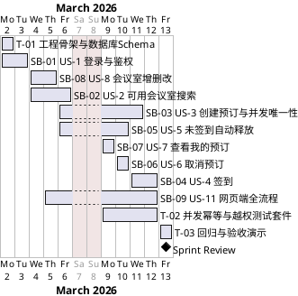

# Sprint 1 迭代计划（sprint_plan.md）

版本：v1.0　依据：`requirements.md` v1.0　时区：Asia/Shanghai（UTC+8）
迭代长度：14 天　Sprint 窗口：2026-03-02（周一）～ 2026-03-15（周日）

---

## 0. 文档约定与编号规则

| 前缀 | 含义 | 说明 |
|---|---|---|
| `SG-x` | 迭代目标的成功标准 | 每条必须可被代码或演示验证 |
| `SB-xx` | 迭代待办中的用户故事项 | 一名一故事，一对一映射 requirements.md 的 US 编号 |
| `T-xx` | 技术使能 / 质量任务 | 不单独产生业务价值，但为 Must 故事的验收前置 |
| `RK-xx` | 风险 | 含触发信号与应对动作 |
| `ASM-xx` | 假设（含需求缺口） | 需求未明确、由本计划代为锁定的判定 |

**验收锚点一律引用 requirements.md 的 AC 编号**（如 `US-3-AC3`），本文件不重写验收标准，避免两处漂移。

---

## 1. 迭代概览

| 项 | 内容 |
|---|---|
| 迭代编号 | Sprint 1 |
| 周期 | 14 自然日（2026-03-02 ～ 2026-03-15），有效工作日 10 天 |
| 团队 | 后端 2、前端 1、QA 1、机动全栈 1；PO 与需求分析各 50% 投入 |
| 可用容量 | 5 人 × 10 工作日 = **50 人日**；扣除计划/评审/回顾与日常支持 8% → **46 人日** |
| 承诺工作量 | 41 SP（≈41 人日）+ 2 人日使能任务 = **43 人日** |
| 剩余缓冲 | **3 人日（≈6.5%）** |
| 演示时间 | 2026-03-13（工作日最后一天）15:00 |
| 计量校准 | 首次迭代按 `1 SP ≈ 1 人日` 标定，Sprint 回顾时用实际速率校准 |

---

## 2. Sprint Goal

> **交付一条真实可用的预订闭环：员工用公司账号登录 → 按条件搜到真正可订的房间 → 成功预订且并发下绝不重复占用 → 按时签到 → 未签到被系统在 60 秒内自动回收 → 主动取消 → 在网页端从头到尾走完上述流程。**

### 2.1 迭代目标的成功标准（供评审会逐条打勾）

| ID | 成功标准（可验证） | 验证方式 |
|---|---|---|
| `SG-1` | 携带无效令牌调用任一 `/api/v1/**` 均返回 `401 UNAUTHENTICATED`；`EMPLOYEE` 调用 `/api/v1/admin/**` 返回 `403 FORBIDDEN`（`US-1-AC2`、`US-1-AC3`） | 自动化集成测试 |
| `SG-2` | 对同一房间同一时段发起 **100 个并发**创建请求，成功数恰为 `1`、其余为 `409 ROOM_SLOT_CONFLICT`，库中有效预订条数恒为 `1`（`US-3-AC3`、`BR-8`） | 压测脚本（`T-02`） |
| `SG-3` | `09:00` 开始且未签到的预订，在 `09:16:00` 之前落库为 `RELEASED / NO_SHOW`，且同一批数据重复触发调度不产生第二条审计（`US-5-AC2`、`US-5-AC5`） | 时钟可控的调度测试 |
| `SG-4` | 时钟从 `09:00` 到 `09:16` 的全链路上，被释放的时段可被第二个员工重新预订并返回 `201`（`US-5-AC3`） | 端到端测试 |
| `SG-5` | 浏览器（Chrome 最新版，视口 1280×800）完成 搜索 → 预订 → 看到“请在 HH:mm 前签到” → 签到 → 取消，全程无需手改请求（`US-11-AC1`～`US-11-AC3`） | 现场演示 |
| `SG-6` | 演示环境中，一次性通过 Must 故事的全部 AC（41 条 AC 中允许 0 条已知失败，允许 ≤3 条记录为已知缺陷并附 issue 编号） | 评审会验收 |

---

## 3. 迭代范围

### 3.1 纳入（Must，本迭代必须交付）

`US-1`、`US-2`、`US-3`、`US-4`、`US-5`、`US-6`、`US-7`、`US-8`、`US-11`

### 3.2 排除（本迭代不做，且不得挤占 Must）

| 故事 | MoSCoW | 排除理由 |
|---|---|---|
| `US-9` 维护时段 | Should | 依赖 `BR-20` 与 `force` 级联取消，涉及 `US-3` 冲突判定复用；本迭代只保证**数据库预留 `maintenance_window` 表结构**（见 `T-01`），接口不实现 |
| `US-10` 使用率报表 | Should | `BR-21` 的 `availableMinutes` 计算需要维护时段数据完整，必须在 `US-9` 之后 |
| `US-12` 管理员查看某日全部预订 | Should | 与 `US-7` 共用查询层，可在 Sprint 2 以 ≤1 人日增量交付 |
| `US-13` 状态变更通知 | Could | 范围外（`requirements.md` §4.2 已排除实际投递） |

### 3.3 范围保护线

若 `2026-03-10`（D7）结束时 `SG-2` 未通过，则**冻结前端新功能、全部人力转入 `SB-03`**，`SB-09` 降级为只交付 `US-11-AC1`（搜索页 + 结果表格）。

---

## 4. 故事点估算与依据

| SB | 故事 | 优先级 | SP | 估算依据（复杂度来源） | 依赖 |
|---|---|---|---|---|---|
| `SB-01` | `US-1` 登录公司账号 | Must | 3 | OIDC 校验 + JWKS 缓存 + 统一鉴权中间件 + 角色断言；`NFR-1` | `T-01` |
| `SB-02` | `US-2` 按条件搜索空闲会议室 | Must | 5 | 容量/设备/状态过滤 + 与预订/维护的区间不重叠子查询 + 分页排序；必须与 `SB-03` 共用同一判定实现（`BR-6`/`BR-7`） | `SB-01`、`SB-08` |
| `SB-03` | `US-3` 创建预订 | Must | 8 | 6 类前置校验的错误码矩阵 + 事务内行级排他锁 + 唯一性兜底约束 + 并发验证；本迭代最高风险项 | `SB-02` |
| `SB-04` | `US-4` 预订签到 | Must | 3 | 签到窗口判定 + 幂等 + 权限与 `ADMIN` 分支（`BR-12`） | `SB-03` |
| `SB-05` | `US-5` 未签到自动释放 | Must | 5 | 独立调度进程 + 分布式锁 + 幂等 UPDATE + 60 秒延迟上限 + 审计写入；与 `SB-04` 共享状态机 | `SB-03` |
| `SB-06` | `US-6` 取消自己的预订 | Must | 2 | 权限 + 状态机 + 并发两次取消只成功一次（`US-6-AC5`） | `SB-03` |
| `SB-07` | `US-7` 查看我的预订 | Must | 2 | 按 `sub` 过滤 + 排序 + `checkInDeadline` 派生字段 + 日期区间校验 | `SB-03`、`SB-01` |
| `SB-08` | `US-8` 管理员增删改会议室 | Must | 5 | CRUD + 字段约束矩阵 + 名称唯一 + 软删除 + 删除前未来预订检查（409 带冲突清单）+ 审计 | `SB-01` |
| `SB-09` | `US-11` 网页端全流程 | Must | 8 | 搜索表单 + 结果表格 + 我的预订即时刷新 + 409 友好提示 + `/admin` 权限分流（`US-11-AC4`） | `SB-01`～`SB-07` |
| **合计** | | | **41** | | |

### 4.1 技术使能与质量任务（不计故事点，计 2 人日）

| T | 任务 | 人日 | 产出 |
|---|---|---|---|
| `T-01` | 工程骨架 + 数据库 Schema + 迁移 | 1 | `room` / `booking` / `maintenance_window` / `audit_log` 四表；`booking(room_id, tstzrange)` 上的排他约束（`btree_gist`）作为 `BR-8` 的数据库兜底 |
| `T-02` | 并发 / 幂等 / 越权测试套件 | 计入 QA 时间 | 100 并发脚本、调度二次触发脚本、IDOR 与 `/admin/**` 越权用例（`NFR-7`） |
| `T-03` | 回归与验收演示准备 | 计入 QA 时间 | 演示数据 + 逐条 AC 核对表 |

> `T-01` 的排他约束是**兜底**，不是替代方案：`NFR-2` 明确禁止“先查后写”的无锁实现，服务层仍须在事务内加行锁。

---

## 5. 迭代甘特图

该图只绘制工作日（周末关闭），因此 10 个有效工作日的排布在图上呈现为 2026-03-02 至 2026-03-13 的连续区间，剩余 2026-03-14～03-15 两日作为缺陷修复与验收缓冲（不计入任务条）。图中并行度最高的一天是 `2026-03-09`：`SB-03`、`SB-05`、`SB-07`、`SB-09`、`T-02` 五条任务同时在场，这正是本迭代唯一需要 5 人全员到齐的日子，也是排期上最脆弱的一天。

**关键路径**：`T-01` → `SB-01` → `SB-02` → `SB-03` → `SB-04` → `T-03` → `Sprint Review`。
`SB-03` 占用 4 个工作日，位于关键路径中段且无浮动时间（浮时为 0）；`SB-09` 有 1 天浮时，`SB-05` 有 2 天浮时。任何针对 `SB-03` 的返工将直接推迟演示——这是把 `SG-2` 设为 `2026-03-10` 熔断点的原因（见 §3.3）。

---

## 6. 依赖与并行说明

| 依赖 | 说明 | 若断裂的后果 |
|---|---|---|
| `SB-02` 与 `SB-03` 共用冲突判定 | 搜索与创建必须调用同一个重叠判定函数（`BR-6`/`BR-7`），否则会出现“搜得到但订不上” | `US-2-AC5` 与 `US-3-AC2` 语义不一致，属于设计级返工 |
| `SB-09` 依赖接口契约而非实现 | 前端自 `2026-03-05` 起基于冻结的 OpenAPI 草案 + mock server 开发 | 契约冻结前不得启动前端，否则 `RK-05` 触发 |
| `SB-04` 与 `SB-05` 共享状态机 | 签到分支与释放分支是同一状态机的两个出口（`BR-12`～`BR-15`） | 两处各写一份将产生 `CHECKED_IN` 被误释放的缺陷 |
| `T-02` 与 `SB-03` 并行 | 并发用例在 `SB-03` 完成前先写失败用例（红），完成后转绿 | 若推迟到 `T-03` 才写，`SG-2` 必然失守 |
| `SB-08` 与 `SB-02` 的数据前提 | 搜索结果的 `status = ACTIVE` 过滤依赖 `SB-08` 的状态字段与软删除语义 | 已删房间可能出现在搜索结果中（`BR-11`、`BR-19`） |

---

## 7. 风险登记册

| ID | 风险 | 可能性 | 影响 | 触发信号 | 应对动作 | 责任 |
|---|---|---|---|---|---|---|
| `RK-01` | `BR-8` 并发唯一性不达标（100 并发出现 2 条成功） | 中 | 高（`SG-2` 直接失败，属数据正确性缺陷） | `T-02` 压测首次运行失败 | 数据库排他约束兜底 + 捕获唯一冲突转 `409 ROOM_SLOT_CONFLICT`；严禁“先查后写” | 后端 A |
| `RK-02` | `ASS-1` 签到窗口语义（`start+15` 释放 vs `start−15` 释放）需求方未答复 | 中 | 高（改动 `BR-12`/`BR-13` 将连带 `US-4`/`US-5`/`US-7` 三条故事） | 需求方在 `2026-03-04` 前未确认 | 把窗口边界定义为单一常量 `CHECKIN_GRACE = 15min`，只在一处引用；`2026-03-04` 未答复则按 `requirements.md` v1.0 的读法锁定并记录 `ASM-05` | 分析 + PO |
| `RK-03` | 时区与自然日边界计算错误（`BR-2` 的 `today+30`、`BR-3` 的 `07:00–22:00`） | 中 | 中 | `US-3-AC5` 在跨日时刻（22:00 前后）失败 | 数据库存 UTC、业务判定统一走 `Asia/Shanghai` 的 `Clock` 抽象，测试覆盖 `21:59`/`22:00`/`22:01` 与跨日 | 后端 B |
| `RK-04` | 调度任务多实例重复处理 | 低 | 高（重复审计与状态覆盖） | `US-5-AC5` 二次触发用例失败 | 分布式锁/单活选举 + `UPDATE ... WHERE status='RESERVED'` 的条件更新保证幂等 | 后端 B |
| `RK-05` | 前后端接口契约变更导致返工 | 中 | 中（`SB-09` 浮时仅 1 天） | 前端连续 2 天需要改 mock | `2026-03-04` 前冻结 OpenAPI 草案，之后变更需 PO 批准并评估浮时 | 全栈 |
| `RK-06` | SSO 测试环境不可用导致 `SB-01` 阻塞 | 中 | 高（关键路径起点） | `2026-03-02` 演示环境无法拿到令牌 | `T-01` 内搭本地 stub IdP（固定 JWKS + 可造 `EMPLOYEE`/`ADMIN` 令牌），真实 SSO 联调延后不阻塞 | 后端 A |
| `RK-07` | `US-8` 软删除遗漏过滤，已删房间仍可预订 | 中 | 中 | `US-8-AC4` 用例失败 | 把所有可用性查询收敛到单一入口方法，禁止各处手写 `status` 条件 | 后端 B |
| `RK-08` | 容量高估：41 SP + 使能任务只剩 3 人日缓冲 | 中 | 中 | `2026-03-10` 燃尽图仍高于理想线 20% | 按 §3.3 熔断，先砍 `SB-09` 的 UI 完整度，再砍 `SB-08` 的批量编辑（本就无此需求） | PO |
| `RK-09` | Should 故事（`US-9`/`US-10`/`US-12`）中途插入 | 中 | 中 | 迭代中出现“顺手做一下”的口头需求 | 明确写入 §3.2；只在 `2026-03-11` 全部 Must 转绿后才允许拉入，且必须换出等量 Must | PO |
| `RK-10` | 测试数据不足导致 `US-10` 之外的报表口径问题被掩盖 | 低 | 低（本迭代不交付报表） | — | `T-03` 演示数据至少覆盖 5 房间 × 4 状态 × 3 天 | QA |

---

## 8. 假设与待确认事项（需求缺口的显式记录）

| ID | 假设 | 若不成立的影响 |
|---|---|---|
| `ASM-01` | 迭代按 **14 自然日**计，团队在周末不排班；甘特图关闭周末，2026-03-14～03-15 为验收缓冲 | 若按 14 个工作日计，交付日期顺延至 2026-03-19，演示需改期 |
| `ASM-02` | 团队 5 人、`1 SP ≈ 1 人日`；这是团队首次迭代的估算基准，回顾时校准 | 速率偏离会使 §7 的 `RK-08` 提前触发 |
| `ASM-03` | 本迭代**只承诺 Must**：`US-1`～`US-8`、`US-11`；`US-9`/`US-10`/`US-12`（Should）与 `US-13`（Could）不排入 | 若 PO 要求插入 Should，须按 `RK-09` 换出等量 Must |
| `ASM-04` | `US-9` 虽不实现，但 `T-01` 必须建出 `maintenance_window` 表；`SB-02`/`SB-03` 的冲突判定**预留维护时段分支**（`BR-7`），仅返回空集 | 若完全不预留，Sprint 2 需重写冲突判定函数 |
| `ASM-05` | 签到窗口采用 `requirements.md` v1.0 / `ASS-1` 的读法：`[start−15min, start+15min]`，在 `start+15min` 未签到才释放 | 若改为 `start−15min` 释放，`BR-12`/`BR-13`、`US-4`、`US-5-AC2`、`US-7-AC2` 全部需改，本迭代 `SB-04`/`SB-05` 需各追加 1 人日 |
| `ASM-06` | 签到主体仅为预订人本人；`ADMIN` 若不是预订人，签到返回 `403`（严格按 `US-4-AC4` 字面执行，不因 `BR-17` 的“权限超集”而放行） | 若业务要求 `ADMIN` 可代签，需新增 AC 并放宽 `SB-04` 的权限分支 |
| `ASM-07` | 周期性预订（范围外）在本期不进入任何故事，`US-7` 的列表不做重复展开 | 若列入下一迭代，`SB-03` 的冲突判定需支持批量事务 |
| `ASM-08` | 通知渠道（邮件/企业微信）不在本期落地（`US-13` Could），`SB-05` 只保证状态变更与审计，不写通知端口 | 若本期要落地，`SB-05` 需追加 2 人日并新增外部依赖风险 |
| `ASM-09` | `US-2` 的 `equipment` 多值参数按“包含全部所需设备”解释（子集语义，`BR-10`），空集合表示不过滤 | 若改为“任一匹配”，`US-2-AC1` 的过滤实现需调整 |

---

## 9. 完成定义（DoD，逐条可验证）

一个 SB 项只有同时满足以下 6 条才计入“完成”：

| ID | 条件 | 验证 |
|---|---|---|
| `DOD-1` | 其引用的**全部 AC 编号**都有对应自动化用例（接口级或端到端），且在当前主干上为绿 | CI 报告按 AC 编号可检索 |
| `DOD-2` | 涉及权限的用例同时覆盖**越权路径**（他人 `bookingId`、非管理员访问 `/admin/**`），`NFR-7` | 用例清单 |
| `DOD-3` | 涉及时间的用例使用可控时钟，不依赖真实等待（`SG-3` 的 16 分钟不得真实等待 16 分钟） | 代码评审 |
| `DOD-4` | 若该故事写审计（`BR-24`），审计记录含操作人、动作、对象 `id`、前后状态、时间戳 | 数据库断言 |
| `DOD-5` | 代码中不出现魔法值：`15min` / `240min` / `30天` / `07:00–22:00` 均为具名常量，且与 `BR-1`/`BR-2`/`BR-3`/`BR-12` 一一对应 | 代码评审 |
| `DOD-6` | 在演示环境（PostgreSQL 14 + 单实例 + 调度进程）上手工走通一遍，并截图归档 | `T-03` 记录 |

---

## 10. 评审会演示脚本（按此顺序打勾即可复现 `SG-1`～`SG-6`）

1. 用 `EMPLOYEE` 令牌调 `GET /api/v1/me` → `200`，`roles = ["EMPLOYEE"]`；换成过期令牌 → `401 UNAUTHENTICATED`（`SG-1`）。
2. 用该 `EMPLOYEE` 令牌调 `POST /api/v1/admin/rooms` → `403 FORBIDDEN`（`SG-1`）。
3. 用 `ADMIN` 令牌创建 `A301`（容量 12，含 `PROJECTOR`/`VIDEO_CONFERENCE`）→ `201`；再用同名创建 → `409 ROOM_NAME_DUPLICATED`（`SB-08`）。
4. 搜索 `2026-03-05 09:00–11:00 / 8 人 / 两种设备`，`A301` 出现在 `items` 中（`SG-2` 前置）。
5. 跑 100 并发脚本抢同一房间同一时段 → 恰 1 个 `201`、99 个 `409`（`SG-2`，最关键的 30 秒）。
6. 把调度时钟推进到 `start_at + 16min` 触发一次 → 该预订 `RELEASED / NO_SHOW`，再触发一次 → 审计条数不变（`SG-3`）。
7. 换第二个员工搜同一时段 → 房间在列表中并可预订成功（`SG-4`）。
8. 浏览器全流程：搜索 → 预订 → 页面提示“请在 `HH:mm` 前签到”→“我的预订”即时出现 → 签到（`CHECKED_IN`）→ 取消（`CANCELLED / EMPLOYEE`）（`SG-5`）。
9. 用 `EMPLOYEE` 打开 `/admin` → 403 页面；换 `ADMIN` → 三个入口可见（`US-11-AC4`）。