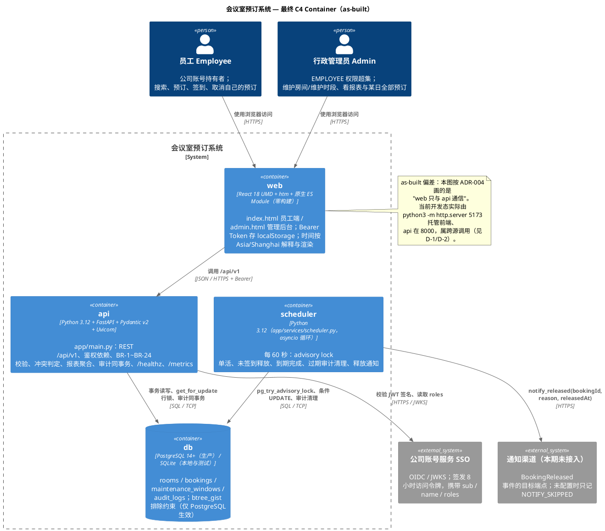

# room-booking — 交付总结（summary.md）

> 依据：`requirements.md`、`architecture.md`(v1.0)、`blueprint.md`(v1.0)、后端/前端交付报告、本次运行实测检查结果。
> 结论口径：**蓝图契约的“类型/接口”层已 100% 落地；“运行形态”层（部署拓扑、存储引擎、前端托管）存在 4 处实质偏差**，均在第 5 节逐条列出。

---

## 1. 结论摘要

| 维度 | 实测 | 判定 |
|---|---|---|
| 蓝图类型契约符合度 | 类图声明 66 个类型，代码命中 66 个（1.0），缺失：无 | ✅ 契约闭合 |
| 图面合法性 | 27 张 PlantUML 图，检查 27 张，修复后不合法 0 张 | ✅ 可回归 |
| 行为验证 | 后端 145 条测试通过（退出码 0，2.50s） | ✅ 语义正确 |
| 部署形态 | 未在 PostgreSQL + 三容器下取得证据 | ⚠️ 见 D-3 / D-4 |
| 前端同源托管 | 实际为 5173 静态服务器 + 8000 API，跨源 | ⚠️ 见 D-1 / D-2 |

一句话：**代码可以按蓝图读，但还不能完全按蓝图跑。** 类型命中率 1.0 度量的是“命名与结构”，不度量“拓扑与引擎”；本系统的全部剩余风险恰好落在后者——这是下节 C4 图之后第 5 节要处理的重点。

---

## 2. 最终架构与组件

### 2.1 运行形态（as-built）

三个进程 + 一个静态站点：

| 名称 | 技术 | 关键文件 | 职责 |
|---|---|---|---|
| `api` | Python 3.12 + FastAPI + Pydantic v2 + Uvicorn + SQLAlchemy 2.0（同步 Session） | `backend/app/main.py`、`app/api/routes.py`、`app/api/deps.py` | 承载 BR-1~BR-24 全部业务规则；JWT 鉴权依赖；冲突判定；报表聚合；审计同事务写入；`/healthz`、`/metrics` |
| `scheduler` | Python 3.12（asyncio 循环 + PostgreSQL advisory lock） | `backend/app/services/scheduler.py` | 60 秒一轮：`pg_try_advisory_lock` 单活、未签到释放、到期完成、过期审计清理、释放后通知 |
| `db` | PostgreSQL 14+（生产）/ SQLite（本地与测试） | `app/persistence/tables.py`、`sqlalchemy_repositories.py` | 唯一性约束、行级锁 `SELECT … FOR UPDATE`、GiST 排除约束、审计留痕 |
| `web` | React 18 UMD + htm + 原生 ES Module（零构建） | `frontend/index.html`、`admin.html`、`js/*.js` | 员工端（搜索/预订/签到/取消/我的预订）与管理后台（房间/维护时段/报表/某日预订） |

`api` 与 `scheduler` **无任何调用关系**，二者只通过 `db` 中的状态字段耦合——这是 NFR-6“调度停摆不阻塞创建预订”的架构表达，也是本系统唯一需要的解耦手段（因此不需要消息队列）。

### 2.2 分层与类型（全部按蓝图同名实现）

```
domain/        Role Equipment RoomStatus BookingStatus CancelReason MaintenanceStatus
               ReportGroupBy AuditAction AuditEntityType
               TimeInterval Room Booking MaintenanceWindow AuditLog UtilizationReport
services/      AuthPrincipal TokenVerifier JwtTokenVerifier OverlapPolicy BookingRules
               BookingService RoomAdminService MaintenanceService ReportService
               AdminBookingService AuditService BookingNotifier LoggingNotifier
               Scheduler SchedulerResult
persistence/   UnitOfWork RoomRepository BookingRepository MaintenanceRepository
               AuditRepository  (+ SqlAlchemy* 五个实现)
api/           ErrorCode ErrorResponse + 20 个请求/响应 DTO
```

### 2.3 必须长期保持的 8 条不变式

1. **半开区间**：`overlaps(a,b) = a.start < b.end and b.start < a.end`；端点相接不冲突（BR-6）。
2. **双保险**：应用层 `OverlapPolicy` 产出 409 语义，数据库 GiST 排除约束兜底并发；`WHERE status IN ('RESERVED','CHECKED_IN')` 让终态自动退出约束（BR-7、US-6-AC1）。
3. **临界区顺序**：先完成全部 400 前置校验，再 `rooms.get_for_update`，最后判重叠——禁止“先查后写”（NFR-2）。
4. **幂等**：签到重复调用返回 200 且不覆盖 `checked_in_at`；调度用 `UPDATE … WHERE id=? AND status='RESERVED'` 的 rowcount 决定是否写审计与通知（US-5-AC5）。
5. **时区**：列 `TIMESTAMPTZ` 存 UTC，自然日/07:00–22:00/30 天窗口一律 `ZoneInfo("Asia/Shanghai")` 折算，禁止裸 `datetime.now()`（NFR-5）。
6. **身份即用户**：`booked_by = token.sub`，无 `users` 表、无外键（ADR-006）。
7. **审计同事务**：状态变更与 `audit_logs` 同事务提交，保留 365 天由 scheduler 清理（ADR-009）。
8. **`check_in_deadline` 不落库**：响应映射期计算 `start_at + 15min`。

---

## 3. 最终 C4 Container 图



---

## 4. 一致性核对（实测证据）

| 检查项 | 方法 | 结果 |
|---|---|---|
| 类型契约 | 类图声明的类型名 ↔ 代码中的类型名 | 66/66，缺失 0，比值 1.0 |
| 图面语法 | 27 张 `.puml` 全量校验 | 27 通过，0 不合法 |
| 用例行为 | `pytest`（145 条，离线、固定时钟 `2025-06-02T01:00Z` = 上海 09:00） | 全绿，2.50 s |
| 验收标准覆盖 | 每条 AC 至少一条断言（401/403、粒度、营业时段、30 天窗、409 冲突、签到窗口两侧、自动释放审计与通知、软删除冲突清单、报表比率 4 位小数…） | 覆盖 |

**已核对一致（非偏差）**：5 态预订状态机迁移、20 个错误码措辞、字段 camelCase、`MaintenanceStatus` 仅 `ACTIVE`、`MaintenanceWindow` 无取消接口、报表不取 `booked_by`、通知为进程内端口。

---

## 5. 代码对蓝图的偏差（逐条）

> 判定口径：以 `blueprint.md` 的类型与接口为“应然”，以交付报告与实测为“实然”。编号即后续处置索引。

| # | 蓝图约定 | 实际实现 | 证据 | 影响 | 处置 |
|---|---|---|---|---|---|
| **D-1** | `web` = TypeScript + React + Vite，构建产物 | React 18 UMD + **htm**，原生 ES Module，**零构建**，无 npm | 前端报告“零构建步骤，无 npm/打包器” | 类型层无影响（前端未在类图声明）；NFR-9 的代码分割、预压缩、构建期检查全部缺位 | 接受为技术债，或 P2 阶段 Vite 化 |
| **D-2** | ADR-004：Vite 产物放 `app/static/`，FastAPI `StaticFiles` 同源托管，`/api/v1/**` 之外回退 `index.html` | FastAPI 无静态路由；前端由 `python3 -m http.server 5173` 托管，API 在 8000 | 前端 README 运行步骤；`app/main.py` 仅 `/healthz`、`/metrics` | **ASS-10（同源）在同源意义上未闭合**；跨源需 CORS 与令牌传递策略调整；本图 `Rel(web, api)` 的“同源无 CORS”前提不成立 | P0，见 N-3 |
| **D-3** | ADR-001/002：PostgreSQL 14+，`SELECT … FOR UPDATE` + `EXCLUDE USING gist` 兜底；测试栈 = testcontainers(PostgreSQL) | 测试与默认运行使用**内存 SQLite**，自定义 `UTCDateTime`（SQLite 存定长 ISO-8601 文本保字典序） | `tests/conftest.py`、`persistence/tables.py`；后端报告“全部离线：内存 SQLite” | **最大证据缺口**：BR-8“100 并发成功数恰为 1”、NFR-2 第二道防线、NFR-3 索引性能均无自动化证据；145 绿测验证的是应用层语义而非约束行为 | P0，见 N-1 |
| **D-4** | `scheduler` = `app/scheduler.py` 的**常驻入口**，独立容器 | 只有 `app/services/scheduler.py` 的 `Scheduler` 类与 `run_forever()`，**无独立进程入口文件** | 后端文件清单无 `app/scheduler.py` | 容器拓扑中的第三个进程当前**不可直接启动**；NFR-4 的 60 秒周期与多实例单活在部署层未取证 | P0，见 N-2 |
| **D-5** | 类图成员即契约 | 三处在序列图/数据流中被使用、但类图未声明：`BookingRules.has_overlap(bookings, maintenance, interval)`、`BookingRules.validate_date_range(from, to)`、`BookingRepository.cancel_for_maintenance(id, now)` | `blueprint.md` 类图 vs US-3/US-7/US-9 序列图 | 契约自洽性缺口；类型命中率统计“只数类型不数成员”，所以仍是 1.0——**这正是度量盲区**。若 force 维护路径改走 `Booking.cancel(MAINTENANCE)+save()`，接口签名需回写 | P1，见 N-6 |
| **D-6** | 类图 `ReportService ..> UnitOfWork` | US-10 序列图与实现均为 `ReportService` 直接执行聚合 SQL，未经仓储端口 | 后端 `report_service.py` | 报表路径绕开端口抽象；单测需 DB 方言兼容（与 D-3 叠加） | P1，随 N-6 一并定稿（改图或改码，二选一） |
| **D-7** | DTO 单一 camelCase 映射（`from_date→from`、`start→startTime`） | 实现额外接受 `fromDate`/`from`、`startTime`/`endTime` 双别名 | 后端报告“双别名兼容” | 接口比契约**更宽松**，OpenAPI 与实现存在出入；前端按 `start`/`end` 传参仍可用 | P2，收敛为单一别名或写入契约 |
| **D-8** | 接口表无“会议室列表”端点 | 管理后台复用 `GET /api/v1/rooms/available`（当日 09:00–10:00）枚举 ACTIVE 房间；删除/维护支持手填 `roomId` | 前端报告“已知契约说明” | 若该时段该房间已被订满，房间**不会出现在列表**→管理操作可达性缺口（非阻断，因有手填兜底） | P1，见 N-4 |
| **D-9** | NFR-9：首屏只加载搜索页 chunk、CSS 1280/768 两档断点 | 单份 `styles.css` + 零构建，无 chunk 概念；断点需人工核对 | 前端 `css/styles.css` | 性能与响应式验收无自动化，只能人工确认 | P2，并入 N-8 |

**偏差分布读法**：D-1/D-2 是“前端形态”，D-3/D-4 是“运行与存储”，D-5/D-6/D-7 是“契约文本与代码的细节错位”，D-8/D-9 是“功能与体验的补口”。**没有一处是类型缺失或业务语义错误**——这与 1.0 的符合度和 145 绿测并不矛盾，而是说明本轮的正确性建立在“类型层”而非“拓扑层”。

---

## 6. 优点

1. **契约可读、可查**：类型名与需求术语一一对应（`ROOM_SLOT_CONFLICT`、`CHECKIN_NOT_OPEN`、`check_in_deadline`），新人可以从类图直接反推 BR 编号。
2. **并发正确性有双保险且可分层验证**：应用层负责 409 语义（可离线单测），数据库约束负责“任何未来写入口”都不会双订（需 PG 验证）。
3. **时间处理只有一种解释**：`timestamptz` + `ZoneInfo("Asia/Shanghai")`，服务器时区改动不影响结果，跨日与 22:00 边界有单测。
4. **克制**：无 Redis、无 MQ、无用户表、无预聚合表、无 K8s——每一项拒绝都在 `architecture.md` §5 有理由，且理由与 ASS-8 的 10 万/年数据量匹配。
5. **幂等设计贯穿写路径**：签到、条件 UPDATE、审计“rowcount=1 才写”，使得重试与重复触发天然安全。
6. **回归成本极低**：145 条测试离线 2.5 秒跑完，且不依赖网络与外部服务——这是可持续交付的底盘。

---

## 7. 局限与风险

| 风险 | 说明 | 严重度 |
|---|---|---|
| **无真实 PG 的 CI** | GiST 排除约束、`FOR UPDATE`、部分唯一索引（“非 DELETED 唯一”）从未被执行过；BR-8 的 100 并发是需求里的硬指标，当前无证据 | 高 |
| **scheduler 不可独立启动** | NFR-4 的“独立进程 + 单活 + 60 秒周期”目前只是类方法，未经进程级验证；若上线时才发现没有入口，会临期返工 | 高 |
| **同源未闭合** | ASS-10 是需求方明确假设；当前跨源，若生产沿用则必须加 CORS 与令牌策略，属于安全面改动 | 中高 |
| **单机可用性天花板** | ADR-010 已显式承担：单主机故障即整体不可用，理论上低于 99.5%；且无备份恢复演练 | 中（已知风险） |
| **报表性能未基准化** | ADR-007 的“10 万条下 3 秒内”是估算，不是测量 | 中 |
| **管理台房间枚举取巧** | 依赖“当日 09:00–10:00 空闲”这一偶然条件 | 中低 |
| **通知不投递** | US-13 为 Could，本期只记 `NOTIFY_SKIPPED`；进程重启会丢事件 | 低（已约定） |

---

## 8. 下一步（按影响排序，含验收判据）

| 优先级 | 动作 | 验收判据 |
|---|---|---|
| **N-1 (P0)** | 把测试迁到真实 PostgreSQL（testcontainers / Compose 服务），新增并发用例 | 100 线程同房间同时段：成功 1、失败 99 且全为 `409 ROOM_SLOT_CONFLICT`；GiST 违反路径被覆盖；CI 含 PG job |
| **N-2 (P0)** | 补 `app/scheduler.py` 独立入口（`python -m app.scheduler`），Compose 起 api/scheduler/db 三容器 | 单端口起三个进程；scheduler 日志可见 60 s 轮次与 advisory lock 获取/释放；`kill -9` 后重启不产生重复释放审计（审计条数不增） |
| **N-3 (P0)** | 实现 ADR-004 同源托管：`StaticFiles` + SPA fallback，前端改为相对路径调 `/api/v1` | 浏览器只访问一个端口即可打开 `index.html`/`admin.html`；响应无 `Access-Control-*` 头；ASS-10 可勾选 |
| **N-4 (P1)** | 新增 `GET /api/v1/admin/rooms`（含 INACTIVE，排除 DELETED，支持分页），管理后台改用它 | 管理后台不再需要手填 `roomId`；删除/维护在任意时段可选到全部房间 |
| **N-5 (P1)** | 10 万预订量级性能基准脚本（366 天 × 50 房间报表、搜索、创建） | 报表 P95 ≤ 3 s、搜索 P95 ≤ 500 ms、创建 P95 ≤ 800 ms（NFR-3）；结果入库为基线 |
| **N-6 (P1)** | 契约回写：把 D-5 三成员写入类图，并定稿 D-6（`ReportService` 是否经 `UnitOfWork`）；把符合度脚本升级为**成员级** | 类图成员是序列图成员的超集；脚本报告“类型 + 成员”两项比值均为 1.0 |
| **N-7 (P2)** | NFR-8 指标落地与告警：`booking_conflict_total`、`auto_release_total`、`scheduler_lag_seconds` | `/metrics` 可抓取三项；scheduler_lag > 120 s 触发告警；仪表看板可查 |
| **N-8 (P2)** | 前端 Vite 化（或至少手工 code-split）+ NFR-9 验收 | 首屏仅加载搜索页 chunk；1280 三列 / 768 单列断点截图留档；构建产物由 api 托管 |
| **N-9 (P2)** | 备份恢复演练 + 月度可用性取证（ADR-010） | 一次 `pg_dump` → 空库 `restore` 演练通过并记录 RTO；月度 uptime 数据可导出 |
| **N-10 (P3)** | 通知渠道 adapter + 重试/去重（US-13 实投） | 配置渠道后 `notify_released` 投递成功；未配置仍只记 `NOTIFY_SKIPPED` 且不影响主事务 |

---

## 9. 附：本轮新增的收尾资产

- `summary.md`（本文）
- 最终容器图：`@startuml room-booking_c4_container_final`（第 3 节，可直接落盘为 `diagrams/room_booking_c4_container_final.puml`）

> 维护约定：任何改动若触及第 2.3 节的 8 条不变式，必须同时更新 `blueprint.md` 与本文第 5 节偏差表；**偏差表归零不等于风险归零**——D-3/D-4 关闭前，BR-8 与 NFR-4 均视为“未验证”而非“已满足”。