# PlantUML syntax reference (PlantUML 1.2026.x)

Every block in this file is parsed by `plantuml -syntax` and rendered in CI
(`scripts/nl2bp_check.py validate references/plantuml-syntax.md`). Copy the shape,
not the content. Read only the sections for the diagrams you are drawing.

## Current rules (what changed since 2024–2025 tutorials)

- **Styling:** `skinparam` is deprecated. Use a `<style>` block or `!theme <name>`.
  Never mix the two in one diagram.
- **Sequence diagrams:** the default engine is Teoz (since 1.2026.7), so
  `!pragma teoz true` is no longer needed. The old `/` merge syntax is deprecated:
  write each message on its own line.
- **Activity diagrams:** use the current syntax (`start`, `:action;`, `if/elseif/else`,
  `fork`, `repeat`, swimlanes `|Lane|`). The legacy `(*) --> "x"` syntax is deprecated.
  Stereotypes go at the **end** of the line: `:Pay fine; <<output>>`.
- **Dedicated start keywords:** non-UML diagrams have their own pair
  (`@startjson`, `@startchart`, `@startgantt`, `@startmindmap`, `@startwbs`,
  `@startsalt`, `@startchen`, `@startfiles`, …). Since 1.2026.3, putting DOT, ditaa or
  network diagrams under `@startuml` is an error.
- **Preprocessor:** variables are written with `$` (`!$api = "REST"`); 1.2026.10 treats
  `$foo` and `foo` as the same variable and warns when `$` is missing.
- **C4:** the C4-PlantUML library ships inside PlantUML (v2.14.0 in 1.2026.10):
  `!include <C4/C4_Container>`. No network access needed.
- **Layout:** without Graphviz, PlantUML falls back to the built-in Smetana engine
  (1.2026.7). Force it with `!pragma layout smetana` for reproducible output.
- **Names:** put a snake_case name after every `@startX`; tooling uses it as the file name.

---

## Use case diagram: who can do what

Use in requirement analysis: actors, use cases, system boundary, `<<include>>` / `<<extend>>`.

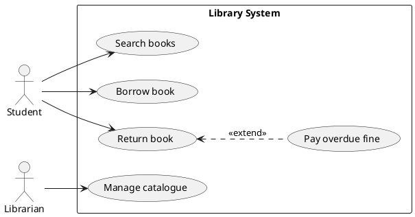

## Activity diagram: workflow with business rules

Use for processes with decisions, parallel steps and responsibilities (swimlanes).

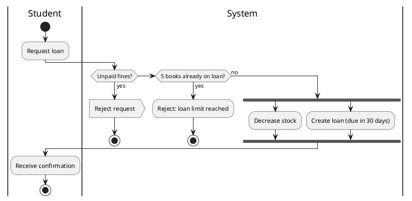

## Sequence diagram: interactions over time

Use for API flows and message order. `++` / `--` activate and deactivate, `return`
answers the last call, `alt` / `opt` / `loop` / `group` frame alternatives.

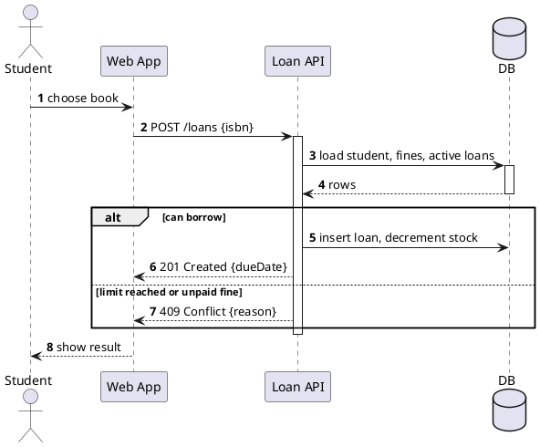

## Class diagram: domain model and services

Use in system design. Declare every type the code must implement; tooling extracts
`class`, `interface`, `enum`, `abstract class`, `record`, `struct`, `entity` names as the
implementation checklist. Show multiplicities on associations.

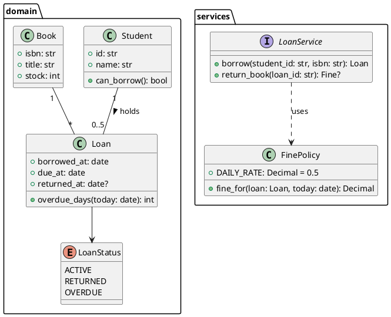

## Component diagram: modules and interfaces

Use to show deployable/logical modules and the interfaces between them.

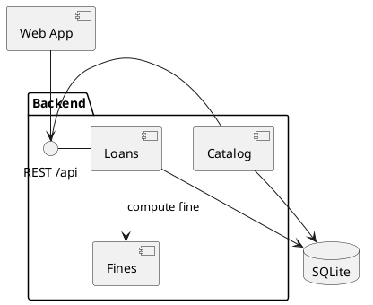

## C4 diagrams: architecture at the right zoom level

Use C4 for architecture overviews: Context (system + people + external systems),
Container (apps, APIs, databases), Component (inside one container). Prefer it over
ad-hoc component diagrams for the system-design stage.

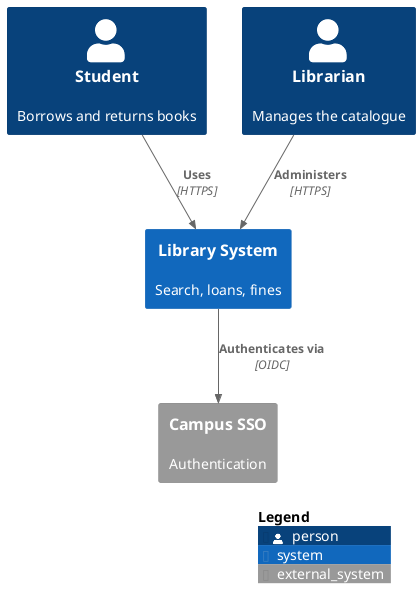

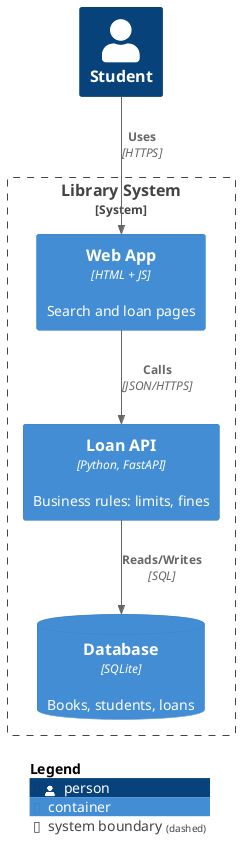

## Deployment diagram: where things run

Use in deployment design: nodes, containers, databases, artifacts, protocols.

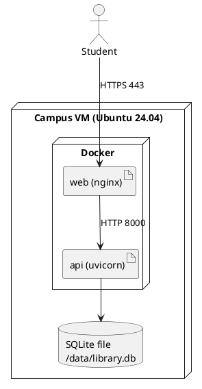

## State diagram: lifecycle of one object

Use for entities with a lifecycle. `<<choice>>` branches on a guard, `<<junction>>`
merges or splits transitions (1.2026.9), composite states nest.

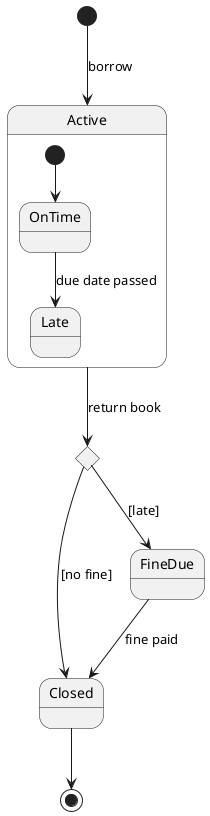

## Entity-relationship diagrams: database schema

IE (crow's foot) notation for physical schemas; mark keys and nullability.

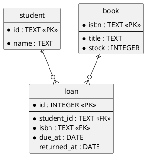

Chen notation (`@startchen`) for conceptual models in requirement analysis:

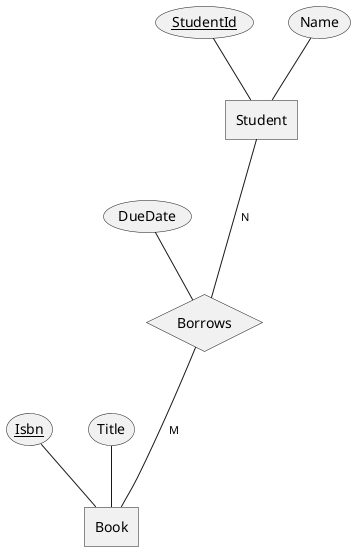

## File structure diagram: project layout

One full relative path per line (never indentation).

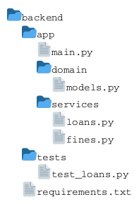

## Timing diagram: protocol or state over time

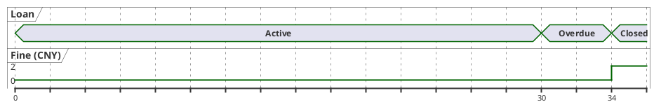

## Gantt diagram: sprint plan

```plantuml
@startgantt library_gantt_sprint1
Project starts 2026-12-01
[Catalogue search] requires 3 days
[Borrow / return API] requires 4 days
[Fines] requires 2 days
[Fines] starts at [Borrow / return API]'s end
[Web pages] requires 3 days
[Web pages] starts at [Catalogue search]'s end
[Sprint review] happens at [Fines]'s end
@endgantt
```

## Chart diagram: metrics such as burndown (new in 1.2026.0)

Use for sprint burndown, test pass rates, and similar numbers.


## Mind map and WBS: requirement decomposition

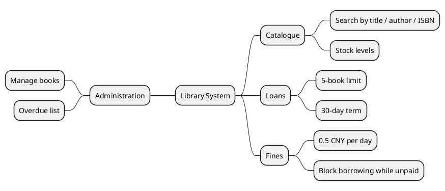

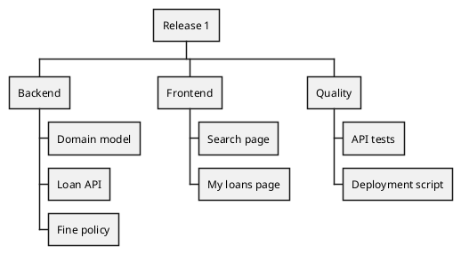

## JSON / YAML: API payloads and configuration

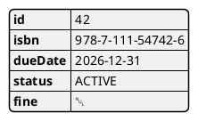

## Salt: low-fidelity UI wireframe

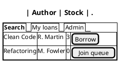

## Styling with `<style>` and themes

```plantuml
@startuml library_style_example
<style>
classDiagram {
  class {
    BackgroundColor #F5F7FF
    LineColor #3355AA
    FontName Helvetica
  }
  arrow {
    LineColor #3355AA
  }
}
.external {
  BackgroundColor #EEEEEE
  LineStyle 4
}
</style>
class LoanService
class CampusSSO <<external>>
LoanService --> CampusSSO
@enduml
```

```plantuml
@startuml library_theme_example
!theme plain
participant Web
participant API
Web -> API : GET /books?q=clean
API --> Web : 200 [..]
@enduml
```

## Common errors and fixes

| Symptom from `plantuml -syntax` | Usual cause | Fix |
|---|---|---|
| `Syntax Error?` on an arrow line | `-> ->`, missing participant name, Markdown inside the block | One arrow per line; plain text only |
| Error on a line with `{` | unbalanced braces in class/state/package | Close every `{` |
| Error on a stereotype line in an activity | stereotype placed before the label | `:Label; <<stereo>>` |
| "Assumed diagram type" is wrong | non-UML content under `@startuml` | Use the dedicated `@startX` keyword |
| Unknown C4 macro | missing include, or a level mismatch | `!include <C4/C4_Container>` (Container includes Context) |
