# Blueprint output contract

Tooling parses the blueprint document, so its format is fixed.

## Document layout

```markdown
# <Project> blueprint

## Assumptions

```plantuml
@startuml <project>_<diagram_type>_<module>
...
@enduml
```

- <every assumption made where the inputs were ambiguous>

## <Diagram type>: <module or feature>



<2–3 sentences: what the diagram shows and the decisions it encodes.>

## Interfaces
| Endpoint / method | Request | Response | Errors |
|---|---|---|---|

## Data flow
<numbered steps for each core use case>
```

## Rules for every diagram block

1. Fence with ```` ```plantuml ````; the first line is `@startX <snake_case_name>` and the
   name is unique in the document (`<project>_<diagram_type>_<module>`).
2. Plain PlantUML only inside the block: no Markdown, no `...` placeholders.
3. Use the dedicated start keyword for non-UML diagrams (`@startchen`, `@startfiles`,
   `@startjson`, `@startgantt`, `@startchart`, …).
4. Style with `<style>` or `!theme`, never `skinparam`.
5. The block must pass `plantuml -syntax`. Run
   `python3 scripts/nl2bp_check.py validate <blueprint.md>` and fix every reported line
   before handing the blueprint on.

## Rules for the class diagram (the implementation contract)

- Declare every domain type and service interface the code must contain, including every
  concept the requirements name (actors and roles, records, policies, schedules, places) —
  none may survive only in prose.
- Give every business rule a named home: an attribute, constant or method on the class that
  enforces it.
- Attribute and method signatures use the target language's types.
- Show multiplicities on associations (`"1" -- "0..5"`).
- `python3 scripts/nl2bp_check.py contract <blueprint.md>` prints the checklist that the
  implementation will be measured against.
